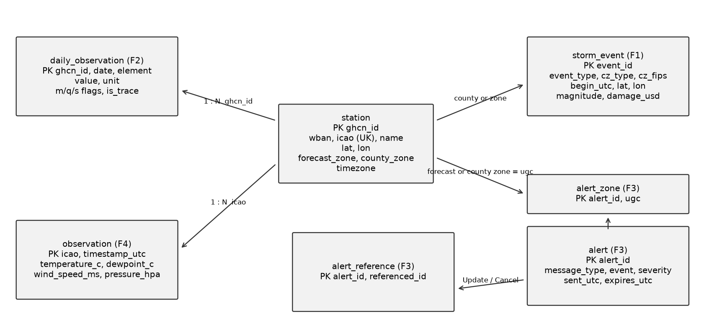
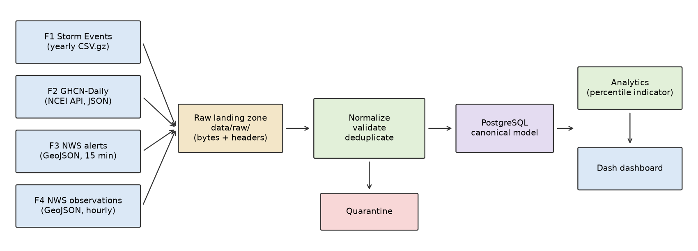

# Workshop 1 Report: Extreme Weather Monitoring in Texas

**Team 5:** Andrés Mendoza, David Martínez, Juan Escallón
**Course:** Data Analysis Programming 2026-II, Universidad Distrital. Prof. Carlos Andrés Sierra.
**Repository:** https://github.com/UD4vyd/proyecto_Prog_data_analysis (branch `main`)

All numbers in this report come from executed outputs of `notebooks/01_source_profiling.ipynb` or from
files in the repository.

## 1. Project overview

**Title.** Extreme Weather Monitoring (Texas).

**Motivation.** Texas has frequent heat waves, freezes and flash floods. A forecast office publishes
warnings, but an analyst also needs to know whether the conditions measured today at a station are
unusual compared with the history of that same station.

**Goal.** Build a pipeline that ingests historical and current data from four public NOAA sources, stores
them in one canonical model, and flags for each station and day whether temperature or precipitation is
normal, unusual or extreme.

**Scope.** Texas, 46 first-order weather stations, daily maximum and minimum temperature and daily
precipitation. Station history from 1991, storm reports from 1996, current observations and alerts.

**Exclusions.** No forecasting, no other states, no radar or satellite data, no hydrological models.
Workshop 1 does not implement ingestion, a database or a dashboard; it defines them.

**Constraints.** Only public sources without paid access. The NWS API needs a `User-Agent` header and
keeps observations only about 7 days. Storm Events data arrive months after the events.

## 2. Hazard definition

| Phenomenon | Measure | Unit | Source |
|---|---|---|---|
| Extreme heat | daily maximum temperature (TMAX) | degC | F2, F4 |
| Extreme cold | daily minimum temperature (TMIN) | degC | F2, F4 |
| Heavy precipitation | daily precipitation (PRCP) | mm | F2, F4 |
| Reported impacts | event type, magnitude, damage | inches, knots, USD | F1 |
| Official warnings | CAP severity (Minor to Extreme) | category | F3 |

**Texas scope.** Three of the four sources (F1, F3, F4) are United States services, so the region must
be in the US. Texas has all the hazards above and many long-record stations.

**Windows.** F2 starts in 1991 because the percentile baseline is the WMO standard normal period
1991-2020. F1 starts in 1996 because before 1996 Storm Events only recorded a few event types, so
earlier frequencies are not comparable.

**Current situation.** F4 observations of the last 24 hours plus F3 alerts active now. The last 7 days
are shown for context.

## 3. Sources and validation evidence

| | F1 Storm Events | F2 GHCN-Daily | F3 NWS alerts | F4 NWS observations |
|---|---|---|---|---|
| Owner | NOAA NCEI | NOAA NCEI | NOAA NWS | NOAA NWS |
| Access | bulk HTTPS listing | REST, Access Data Service | REST, api.weather.gov | REST, api.weather.gov |
| Auth | none | none | none, User-Agent required | none, User-Agent required |
| Limits | none documented | none documented | no number published | no number published |
| License | US public data | US public data | US public data | US public data |
| Format | CSV.gz, 51 fields | JSON, values as strings | GeoJSON with CAP fields | GeoJSON, value objects |
| Coverage | US, 1950-2026 files | station-days | last 7 days, active now | about 7 days per station |
| Update | yearly file recompiled (`_cYYYYMMDD`) | daily, values can be re-published | continuous | about 5 reports per hour |

URLs: F1 `https://www.ncei.noaa.gov/pub/data/swdi/stormevents/csvfiles/`, F2
`https://www.ncei.noaa.gov/access/services/data/v1?dataset=daily-summaries`, F3
`https://api.weather.gov/alerts?area=TX` and `/alerts/active?area=TX`, F4
`https://api.weather.gov/stations/{icao}/observations`. Every response is saved byte for byte in
`data/raw/` or `workshop_1/samples/` with a `.headers.json` file (URL, status, UTC time, HTTP headers).
The validation dates are in `docs/source_status_log.md`.

**F1 snippet** (`storm_events_tx_d2025_c20260819.csv`, selected fields):

```
EVENT_ID=1230425 STATE_FIPS=48 EVENT_TYPE=Hail CZ_TYPE=C CZ_FIPS=75 CZ_NAME=CHILDRESS
BEGIN_DATE_TIME=02-MAR-25 14:15:00 CZ_TIMEZONE=CST-6 MAGNITUDE=1.00 DAMAGE_PROPERTY=0.00K
BEGIN_LAT=34.3867 BEGIN_LON=-100.0866
```

**F2 snippet** (`ghcn_daily_3st_2025_20261116_235238.json`, first record):

```
{"DATE":"2025-01-01","STATION":"USW00003927","PRCP_ATTRIBUTES":",,W","TMAX":"10.0",
 "TMAX_ATTRIBUTES":",,W","TMIN":"2.2","PRCP":"0.0","TMIN_ATTRIBUTES":",,W"}
```

**F3 snippet** (active alerts, poll 1, selected properties):

```
"id": "urn:oid:2.49.0.1.840.0.0031146a47a58e058776b0015d3245f6a6d8ff5d.001.1",
"event": "Coastal Flood Advisory", "messageType": "Update", "severity": "Minor",
"sent": "2026-11-16T16:49:00-06:00", "expires": "2026-11-17T01:00:00-06:00",
"references": [{"identifier": "urn:oid:2.49.0.1.840.0.da52aa5b...001.1",
                "sent": "2026-11-16T00:44:00-06:00"}]
```

**F4 snippet** (KDFW, poll 1, first feature):

```
"geometry": {"type": "Point", "coordinates": [-97.03, 32.9]},
"stationId": "KDFW", "timestamp": "2026-11-16T22:55:00+00:00",
"temperature": {"unitCode": "wmoUnit:degC", "value": 16, "qualityControl": "V"},
"windGust": {"unitCode": "wmoUnit:km_h-1", "value": null, "qualityControl": "Z"}
```

## 4. Station selection and crosswalk

Criterion: "All first-order (USW) GHCN-Daily stations in Texas with TMAX, TMIN and PRCP records from 1991
or earlier to 2025 or later, that have an ICAO identifier in the NOAA ISD station history and are published
by the NWS API." The result is `config/stations.csv`. The notebook rebuilds it from `data/raw/`.

| Step | Input | Result |
|---|---|---|
| 1. USW prefix and state TX | `ghcnd-stations.txt` (133,041 stations) | 171 stations |
| 2. TMAX, TMIN, PRCP with first year <= 1991 and last year >= 2025 | `ghcnd-inventory.txt` | 48 stations |
| 3. WBAN (last 5 digits of the id) joined with ISD history to get ICAO | `isd-history.csv` | 47 stations (LONGVIEW WSMO has no ICAO) |
| 4. ICAO present in the NWS Texas catalogue | 9 pages, 3,851 stations | 47 stations, all published |
| 5. One GHCN id per ICAO, uniqueness asserted | | 46 stations |

We chose first-order stations because they are the airports that also report to the NWS, so the same
sensor appears in F2 (history) and F4 (now). The trade-off is fewer stations than the cooperative network,
but every station can be compared with itself.

Problems found during the selection:

- ISD uses `99999` for a missing WBAN (25,367 of 29,661 rows) and `999999` for USAF. We convert them to NULL.
- One WBAN can have several ISD rows (station history). This first produced duplicated stations, which we
  detected because the first GHCN request returned USW00003904 twice (730 rows, 365 duplicated
  station-days). We keep the latest row per WBAN (sorted by END) and assert uniqueness.
- Two GHCN ids map to KFTW: FT WORTH MEACHAM FLD (WBAN 13961, ISD END 2025-08-27) and FT WORTH MEACHAM FLD
  NAAF (WBAN 93904, ISD END 1945-11-30). We keep the one with the latest ISD row.
- The NWS catalogue uses a cursor. Pages 1 to 8 have 500, 500, ... and 351 features, and the last `next`
  link returns an empty page, so the loop stops on an empty `features` list.
- The inventory only gives first and last year, not gaps, so completeness is checked on the daily data.

## 5. Profiling results and data-quality findings

**F2 sample** (KDFW, KIAH, KAUS, 2025, TMAX/TMIN/PRCP): 1,095 rows, no duplicates on (STATION, DATE) and
no missing days against the calendar. PRCP has 2 nulls (0.18%). Ranges: TMAX from -2.1 to 40.0 degC
(KDFW), TMIN down to -11.0 degC, PRCP up to 100.3 mm. No row has TMIN > TMAX. Quality flags are all
blank. Source flags are `W` from January to most of August and `1` from late August to December
(714 and 381 values for TMAX). We do not have documentation for the flag `1`, so we only note that recent
months come from another source stream. 133 days are trace precipitation.

**F1 2025** (`StormEvents_details-ftp_v1.0_d2025_c20260819.csv.gz`): 72,360 US rows and 5,641 Texas rows,
51 fields, no duplicated EVENT_ID. 3,572 county rows and 2,069 zone rows. Time zones: `CST-6` (5,530) and
`MST-7` (111). Main types: Hail 1,453, Thunderstorm Wind 1,205, Flash Flood 624, Drought 611, High Wind 448,
Heat 347.

**F3 poll 1:** 172 alerts in the last 7 days and 6 active, no duplicated ids. 85 Alert, 67 Update and 20
Cancel messages; severity Moderate 79, Minor 61, Severe 32. Most frequent events: Flood Warning 31,
Dense Fog Advisory 31, Flood Advisory 29.

**F4 poll 1:** 500 records per station covering 94.6 h (KAUS), 97.2 h (KDFW) and 88.5 h (KIAH). No
duplicates on (station, timestamp). Temperature null 0.1%, range 7.0 to 27.2 degC, QC codes V (1,498)
and Z (2).

Data-quality problems (full table with handling in `workshop_1/data_quality_issues.csv`):

| # | Source | Problem | Extent | Example |
|---|---|---|---|---|
| 1 | F2 | Numbers arrive as JSON strings | all values | USW00003927 2025-01-01 `"TMAX": "10.0"` |
| 2 | F2 | Missing days are absent rows, not nulls | 2 days in the first query | USW00003902, no rows for 2025-08-30 and 2025-08-31 |
| 3 | F2 | Trace precipitation is 0.0 with flag T | 133 of 1,095 rows | USW00003927 2025-01-05 PRCP=0.0, `T,,W` |
| 4 | F2 | Duplicated station-days after bad crosswalk | 365 rows | USW00003904, 730 rows for 2025 |
| 5 | ISD | Two GHCN ids share one ICAO | 1 code | USW00013961 and USW00093904 both KFTW |
| 6 | ISD | Sentinel 99999 for missing WBAN | 25,367 rows | USAF=007018, WBAN=99999 |
| 7 | F1 | Local standard time, offset field, 2-digit year | all rows | EVENT_ID 1230373, `09-JAN-25 20:00:00`, `CST-6` |
| 8 | F1 | Damage as text with K/M suffix, blank is unknown | 15.7% blank | EVENT_ID 1256818, `10.00K` |
| 9 | F1 | MAGNITUDE unit depends on event type | hail and wind rows | EVENT_ID 1230425 Hail 1.00 (in); wind in knots |
| 10 | F1 | Zone rows have no coordinates | 2,069 of 2,069 zone rows | EVENT_ID 1230373, Coastal Flood, CZ_TYPE=Z |
| 11 | F3 | `sent` has local offsets, not UTC | -06:00 (166), -07:00 (6) | `2026-11-16T16:49:00-06:00` |
| 12 | F3 | Alerts without geometry | 77 of 172 | Rip Current Statement, UGC TXZ345, TXZ442 |
| 13 | F3/F4 | GeoJSON order is [lon, lat] | all features | KAUS `[-97.67, 30.19]` |
| 14 | F4 | Value objects with `value: null` | windGust 94.9% null | KAUS 2026-11-16T22:55Z windGust null, QC Z |
| 15 | F4 | Default response capped at 500 records | 88.5 to 97.2 hours | KDFW from 2026-11-12 21:40 to 2026-11-16 22:55 UTC |

Two decisions come from this table. First, trace days keep `PRCP = 0.0` with a boolean `is_trace`, so
wet-day statistics can include or exclude them. Second, F1 damage blanks stay NULL, because 0 would
claim that no damage happened.

## 6. Incremental behaviour from the two polls

POLL_SECTION

## 7. Cross-source overlap

F2 and F4 describe the same physical station by construction, because the crosswalk links each GHCN id
to its ICAO code (for example USW00003927 is KDFW). The open question for Workshop 3 is the day
definition: F2 uses the local station day and F4 timestamps are UTC.

For F1 and F2 we searched candidate pairs for the three sample stations in 2025: an F1 event in the
station county (county row with the county FIPS of `county_zone`) or zone (zone row with the number of
`forecast_zone`), on the same local day, with a compatible variable (heat to TMAX, cold and winter to
TMIN, flood, rain, hail and storm to PRCP). We found 143 candidate pairs. Examples:

| F1 event | Type | Area | Local start | F2 station | F2 value |
|---|---|---|---|---|---|
| 1231214 | Winter Storm | Z DALLAS | 09-JAN-25 10:00 | KDFW 2025-01-09 | TMIN -0.5 |
| 1234272 | Winter Weather | Z TRAVIS | 22-FEB-25 02:00 | KAUS 2025-02-22 | TMIN -1.0 |
| 1231497 | Winter Storm | Z INLAND HARRIS | 20-JAN-25 18:00 | KIAH 2025-01-20 | TMIN -2.1 |
| 1287952 | Heat | Z DALLAS | 24-JUL-25 11:00 | KDFW 2025-07-24 | TMAX 36.7 |
| 1292129 | Heat | Z DALLAS | 15-AUG-25 11:00 | KDFW 2025-08-15 | TMAX 36.7 |
| 1300291 | Flash Flood | C DALLAS | 20-NOV-25 05:30 | KDFW 2025-11-20 | PRCP 100.3 |

What differs between the two sides: F1 is a report for a county or zone in local standard time, F2 is
one value per station and day. Several F1 events can match one F2 day (three Flash Flood reports on
2025-11-20). A hail or wind report only says that a storm happened in the county, not that the station
measured it. So these are candidates for validation, not confirmed matches.

## 8. Canonical mapping and domain tables

Every source fills the canonical `event` record: `event_id`, `source`, `event_type`, `timestamp_utc`,
`latitude`, `longitude`, `severity` with `severity_unit`, and `raw_reference`. The full field-by-field
mapping, the unit rules and the time rules are in `workshop_1/mapping.md`. Main rules: all timestamps in
UTC (F1 local time plus the `CZ_TIMEZONE` offset, F3 parsed with its offset), GeoJSON `[lon, lat]`
swapped, wind in m/s, pressure in hPa, hail in mm, damage in USD.

The domain tables keep the detail of each source: `station`, `daily_observation` (F2), `observation`
(F4), `storm_event` (F1), `alert`, `alert_zone` and `alert_reference` (F3).



## 9. Ingestion contract

| | F1 | F2 | F3 | F4 |
|---|---|---|---|---|
| Historical | one file per year, 1996 on | one request per station and year, 1991 on | none | none |
| Incremental | re-load a year when `_cYYYYMMDD` changes | per station from max DATE - 30 days | every 15 min | every hour per station |
| Watermark | compilation date | max DATE | max `sent` - 2 h | max `timestamp` - 3 h |
| Duplicate key | EVENT_ID | (station, date, element) | alert `id` | (station, timestamp) |
| Revisions | year file replaced | upsert | Update/Cancel linked by `references` | upsert |

Failure rule: the raw file is saved first, parsing reads it from disk, and the watermark only moves after
a successful load. Details in `docs/ingestion_contract.md`.

**Volume estimate.** F2: 46 stations x 36 years x 365 days = 604,440 station-days, or 1,813,320 values
for three elements, in 1,656 requests of about 0.06 MB each (about 99 MB of JSON). F1: 31 yearly files
from 1996 to 2026, 313 MB compressed for the whole US; the 2025 file is 12.6 MB with 5,641 Texas rows.
F4: about 5.4 reports per station per hour, about 2.2 million per year for 46 stations. Partitioning:
F1 by year file, F2 by station and year, F3 and F4 by poll time.

## 10. Functional user

An emergency-management analyst in a Texas state or county office. The analyst monitors current
conditions and needs to know, for each station, whether today is unusual compared with its history, and
whether there is an official alert in that zone.

## 11. User stories

| # | Story | Area | MoSCoW |
|---|---|---|---|
| 1 | As an analyst, I want to see the alerts that are new since my last check, so I can react first to what changed. | monitoring | Must |
| 2 | As an analyst, I want the latest observation of every station on one map, so I can see the current situation in Texas. | monitoring | Must |
| 3 | As an analyst, I want each station-day labelled NORMAL, UNUSUAL or EXTREME against 1991-2020, so I know if today is unusual. | analysis | Must |
| 4 | As an analyst, I want to see whether a station with an EXTREME label is inside an active alert zone, so I can compare our flag with the official warning. | analysis | Should |
| 5 | As an analyst, I want the time of the last successful load per source, so I know how fresh the data are. | trust | Must |
| 6 | As an analyst, I want the completeness of each station (missing days, null values), so I do not trust a station with gaps. | trust | Should |
| 7 | As an analyst, I want past EXTREME days next to Storm Events reports of the same county, so I can judge if the indicator is useful. | analysis | Could |
| 8 | As an analyst, I want forecasts for the next days. | analysis | Won't (out of scope) |

## 12. Indicator proposal

For each station, element (TMAX, TMIN, PRCP) and day of year, we compute percentiles from the 1991-2020
baseline using all days within +/-7 days of that day of year (15 days x 30 years, about 450 values). A
new value is NORMAL between p10 and p90, UNUSUAL outside p10-p90, and EXTREME below p1 or above p99.
The thresholds are parameters. For PRCP only the upper side is meaningful, and trace days can be
included or excluded with `is_trace`.

Validation: we will check whether days marked EXTREME in the past match F1 events in the station county
on the same local day, for example the summer 2011 heat and the Hurricane Harvey rain in August 2017.
The indicator is a monitoring aid that describes how rare a measured value is. It is not a prediction.

## 13. Risks and mitigation

| Risk | Impact | Mitigation |
|---|---|---|
| F4 keeps about 7 days, and the default response only had 88 to 97 hours | an outage longer than that loses data for good | hourly polls with `start`, alert when a watermark is older than 24 h |
| Rate limits and User-Agent rules of the NWS API | blocked requests | User-Agent with contact from `.env`, respect `Cache-Control`, back-off on errors |
| Schema changes in any source | parsing fails | raw files kept, validation step, quarantine for rows that fail |
| F1 delay and recompilations | recent months missing, old years change | use F1 only for history, re-load a year when its `_cYYYYMMDD` changes |
| Ambiguous identifiers in the crosswalk | duplicated or wrong stations | latest ISD row per WBAN, one GHCN id per ICAO, uniqueness asserts |
| Re-published F2 values | stale values in the database | 30-day overlap and upsert on (station, date, element) |
| Data volume of the backfill | long first load | partition by year and station, resume from the watermark |

## 14. Architecture overview

Sources go to a raw landing zone (`data/raw/`, bytes plus headers). A normalization step validates,
converts units and time, and removes duplicates; rows that fail go to quarantine. Clean rows go to the
PostgreSQL canonical model. The analytics layer computes the percentile indicator, and a Dash dashboard
shows the current situation.



## 15. Repository and references

Repository: https://github.com/UD4vyd/proyecto_Prog_data_analysis. Deliverables: notebook
`notebooks/01_source_profiling.ipynb`, `workshop_1/mapping.md`, `workshop_1/data_quality_issues.csv`,
`docs/ingestion_contract.md`, `config/sources.yaml`, `config/stations.csv`, evidence in
`workshop_1/samples/` and `data/raw/`.

- NOAA National Centers for Environmental Information. Storm Events Database.
  https://www.ncei.noaa.gov/stormevents/
- Menne, M. J., et al. Global Historical Climatology Network - Daily (GHCN-Daily), Version 3. NOAA
  National Climatic Data Center. doi:10.7289/V5D21VHZ
- NOAA NCEI. Access Data Service API documentation.
  https://www.ncei.noaa.gov/support/access-data-service-api-user-documentation
- NOAA NCEI. Integrated Surface Database station history (isd-history.csv).
- National Weather Service. API Web Service documentation. https://www.weather.gov/documentation/services-web-api
