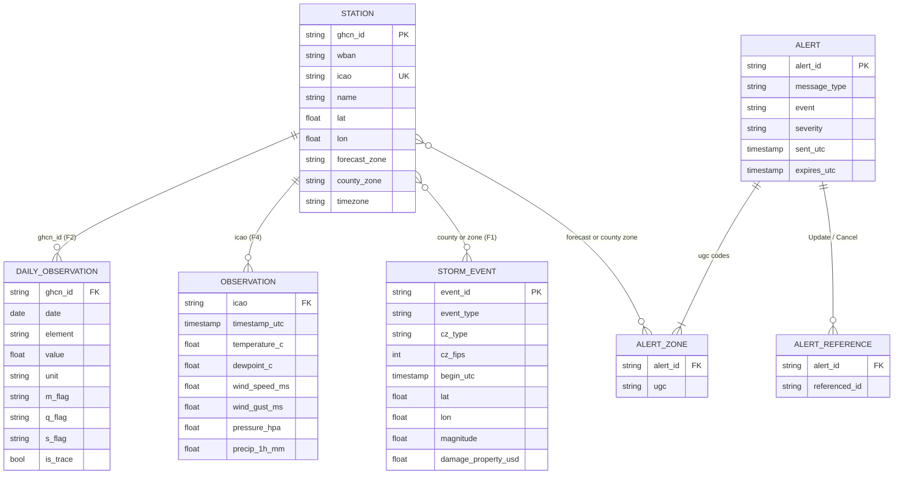

# Canonical mapping (draft, Workshop 1)

This is a first draft. It shows that every source can fill the canonical `event` record and which
rules are needed to do it. The domain tables below keep the full detail of each source. Field names
come from the samples profiled in `notebooks/01_source_profiling.ipynb`.

## 1. Canonical `event` record

| Field | Meaning |
|---|---|
| event_id | Unique id inside the project: source label plus the source key |
| source | F1, F2, F3 or F4 |
| event_type | Phenomenon or measured variable |
| timestamp_utc | Start time of the event or time of the measurement, ISO 8601 in UTC |
| latitude, longitude | Decimal degrees (WGS84), NULL when the source only gives a zone |
| severity, severity_unit | Main magnitude and its unit after unit conversion |
| raw_reference | Raw file name plus the source key, so every row can be traced back |

## 2. Mapping per source

### F1 NOAA Storm Events (details CSV)

| Canonical field | Native field(s) | Rule |
|---|---|---|
| event_id | EVENT_ID | `F1:` + EVENT_ID (unique in the 2025 Texas sample) |
| source | constant | `F1` |
| event_type | EVENT_TYPE | as is (Hail, Thunderstorm Wind, Flash Flood, Heat, ...) |
| timestamp_utc | BEGIN_YEARMONTH, BEGIN_DAY, BEGIN_TIME, CZ_TIMEZONE | build local standard time from the three fields (not from the 2-digit year in BEGIN_DATE_TIME), then add the offset: `CST-6` means UTC = local + 6 h, `MST-7` means UTC = local + 7 h |
| latitude, longitude | BEGIN_LAT, BEGIN_LON | NULL for zone rows (`CZ_TYPE=Z`, 2,069 of 5,641 rows in 2025) |
| severity, severity_unit | MAGNITUDE, EVENT_TYPE | Hail: inches x 25.4 = mm. Wind types: knots x 0.5144 = m/s. Other types: NULL (damage goes to `storm_event`) |
| raw_reference | file name + EVENT_ID | for example `StormEvents_details-ftp_v1.0_d2025_c20260819.csv.gz#1230373` |

Texas rows are selected with `STATE_FIPS == "48"`. Damage text (`10.00K`, `1.50M`) is parsed to USD in
`storm_event`, and a blank stays NULL because it means unknown.

### F2 GHCN-Daily (NCEI Access Data Service, JSON)

| Canonical field | Native field(s) | Rule |
|---|---|---|
| event_id | STATION, DATE, element | `F2:USW00003927:2025-01-01:TMAX` |
| source | constant | `F2` |
| event_type | element name | TMAX, TMIN, PRCP |
| timestamp_utc | DATE | the day is a local day at the station; we store the date in `daily_observation` and use local midnight converted to UTC for the event |
| latitude, longitude | station table | from `config/stations.csv` (GHCN coordinates) |
| severity, severity_unit | TMAX, TMIN, PRCP | string to number with `pd.to_numeric(errors="coerce")`; units are degC and mm because we request `units=metric` |
| raw_reference | raw file + STATION + DATE | |

The `<ELEMENT>_ATTRIBUTES` string is split into measurement, quality and source flags. Trace days
keep `PRCP = 0.0` and get `is_trace = true`.

### F3 NWS alerts (GeoJSON with CAP fields)

| Canonical field | Native field(s) | Rule |
|---|---|---|
| event_id | properties.id | `F3:` + id (`urn:oid:...`) |
| source | constant | `F3` |
| event_type | properties.event | as is (Flood Warning, Wind Advisory, ...) |
| timestamp_utc | properties.sent | parse with its offset (`-06:00`, `-07:00`) and convert to UTC |
| latitude, longitude | geometry | centroid of the polygon; coordinates are `[lon, lat]`; NULL when geometry is null (44.8% in poll 1), then the alert is located by `geocode.UGC` |
| severity, severity_unit | properties.severity | CAP category (Minor, Moderate, Severe, Extreme, Unknown), unit `CAP category` |
| raw_reference | raw file + id | |

`messageType` (Alert, Update, Cancel) and `references` are kept in `alert` and `alert_reference`, so
an Update or Cancel can be linked to the first message.

### F4 NWS station observations (GeoJSON)

| Canonical field | Native field(s) | Rule |
|---|---|---|
| event_id | properties.stationId, properties.timestamp | `F4:KDFW:2026-11-16T22:55:00Z` |
| source | constant | `F4` |
| event_type | constant | `observation` (one event per report; variables go to `observation`) |
| timestamp_utc | properties.timestamp | already UTC (`+00:00`) |
| latitude, longitude | geometry.coordinates | `[lon, lat]`, so lat = coordinates[1], lon = coordinates[0] |
| severity, severity_unit | temperature.value | degC; the other variables are columns of `observation` |
| raw_reference | raw file + stationId + timestamp | |

Each variable is an object `{value, unitCode, qualityControl}`. We keep the value and the QC code and
convert the unit. A null is `value: null` and stays NULL.

## 3. Unit and time rules

| Quantity | Canonical unit | Conversions |
|---|---|---|
| Temperature | degC | F2 and F4 already in degC |
| Precipitation | mm | F2 metric is mm, F4 `wmoUnit:mm` |
| Wind speed | m/s | F4 `wmoUnit:km_h-1` / 3.6, F1 knots x 0.5144 |
| Pressure | hPa | F4 `wmoUnit:Pa` / 100 |
| Hail size | mm | F1 inches x 25.4 |
| Damage | USD | F1 K = 1e3, M = 1e6, B = 1e9 |

- All stored timestamps are UTC. The original local value is kept in the domain table when the source
  gives one (F1 local time, F3 offset).
- F2 dates are local station days. To compare them with F1 we use the F1 local day (BEGIN_YEARMONTH
  and BEGIN_DAY), not the UTC day.
- Coordinates are stored as (latitude, longitude). GeoJSON `[lon, lat]` is swapped when mapping.

## 4. Proposed domain tables

| Table | Source | Key | Main columns |
|---|---|---|---|
| station | config (F2 + ISD + NWS) | ghcn_id | wban, icao (unique), name, lat, lon, forecast_zone, county_zone, timezone |
| daily_observation | F2 | (ghcn_id, date, element) | value, unit, m_flag, q_flag, s_flag, is_trace, raw_file, loaded_at |
| observation | F4 | (icao, timestamp_utc) | temperature_c, dewpoint_c, wind_speed_ms, wind_gust_ms, pressure_hpa, precip_1h_mm, qc codes, raw_file |
| storm_event | F1 | event_id | episode_id, event_type, cz_type, cz_fips, cz_name, begin_local, cz_timezone, begin_utc, end_utc, lat, lon, magnitude, magnitude_type, damage_property_usd, source_file |
| alert | F3 | alert_id | message_type, event, severity, certainty, urgency, sent_utc, onset_utc, expires_utc, area_desc, raw_file |
| alert_zone | F3 | (alert_id, ugc) | one row per UGC code of the alert |
| alert_reference | F3 | (alert_id, referenced_id) | links Update and Cancel messages to earlier ones |

Links between sources: `daily_observation` and `observation` join through `station` (crosswalk
ghcn_id to icao). `storm_event` joins `station` when `cz_type = C` and `cz_fips` equals the county part
of `county_zone`, or when `cz_type = Z` and `cz_fips` equals the zone part of `forecast_zone`.
`alert_zone.ugc` joins `station.forecast_zone` or `station.county_zone`.

## 5. ER draft

