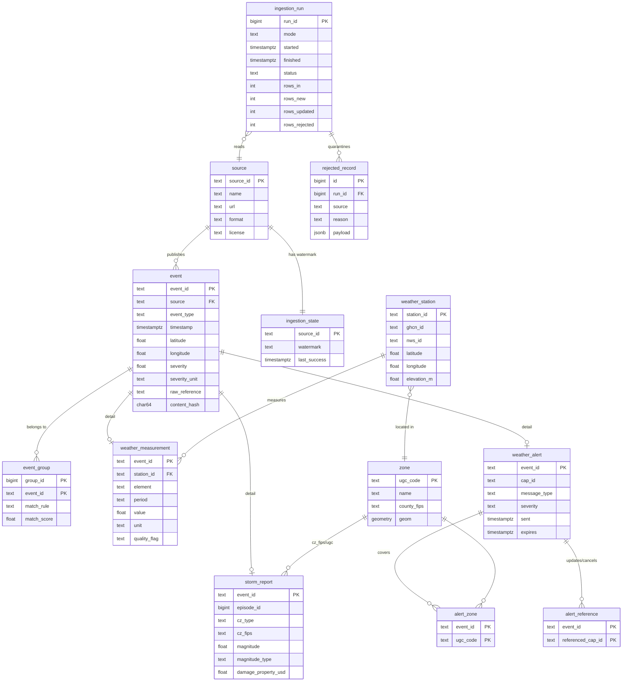

# Canonical Mapping — Team 5 Extreme Weather Monitoring (Texas)

This document maps every field of the four sources onto the common `event` model defined in the
Course Project, proposes the hazard-specific domain tables, and fixes the normalisation rules.
The rules are implemented (draft) in `src/normalization/canonical.py` and exercised in
`notebooks/01_source_profiling.ipynb`, section 5.

## 1. Global normalisation rules

| Aspect | Rule |
|---|---|
| Timestamps | Stored as `TIMESTAMPTZ` in **UTC**. Sources with local time are converted with their explicit offset (Storm Events `CZ_TIMEZONE`, NWS ISO-8601 offset). |
| Daily values | A GHCN-Daily "day" at first-order stations is the **local standard-time day**. `timestamp` = local midnight (LST) converted to UTC (06:00Z for UTC−6, 07:00Z for UTC−7 / El Paso). The domain table keeps `obs_date` and `period = 'P1D'`. |
| Coordinates | WGS84 (EPSG:4326), decimal degrees, `latitude ∈ [-90, 90]`, `longitude ∈ [-180, 180]`; additionally flagged if outside the Texas bounding box padded by 0.5°. |
| Missing coordinates | Storm Events zone rows and NWS alerts without polygon get the **centroid of the county / forecast zone** (from the NWS zones endpoint / Census county shapes, Workshop 2) and `location_method = 'zone_centroid'`; never invented points. |
| Temperature | °C (GHCN `units=metric` already °C; NWS `wmoUnit:degC`). |
| Wind | m/s. knots × 0.514444 (Storm Events), km/h ÷ 3.6 (NWS `wmoUnit:km_h-1`). |
| Precipitation / snow | mm. inches × 25.4 if ever received in standard units; NWS `wmoUnit:mm` as is. |
| Hail size | mm (inches × 25.4). |
| Unit conversion | Always driven by the unit **declared in the record** (`unitCode`, `units=metric`, event type), never assumed per field. Unknown unit → record to `rejected_record`. |
| Severity | `severity` (numeric) + `severity_unit` (text). Physical magnitude when the source has one; otherwise an ordinal scale named in `severity_unit` (see §3). |
| Identifiers | `event_id` = `<source_key>:<native key>` (deterministic, so re-runs are idempotent). |
| Change detection | `content_hash` = SHA-256 of the raw record serialised with sorted keys. Same `event_id` + different hash ⇒ revision ⇒ update row and keep previous version in the raw landing zone. |
| Text | Event types normalised to `snake_case` (`Thunderstorm Wind` → `thunderstorm_wind`). |

## 2. Source → canonical `event` mapping

### H1 — NOAA Storm Events (`noaa_storm_events`, one row per `EVENT_ID`)

| Canonical field | Source field(s) | Transformation |
|---|---|---|
| event_id | `EVENT_ID` | `'noaa_storm_events:' + EVENT_ID` |
| source | — | constant `noaa_storm_events` |
| event_type | `EVENT_TYPE` | snake_case (`Flash Flood` → `flash_flood`) |
| timestamp | `BEGIN_YEARMONTH`, `BEGIN_DAY`, `BEGIN_TIME`, `CZ_TIMEZONE` | build local time from the 4-digit-year fields (not the 2-digit `BEGIN_DATE_TIME`), subtract offset parsed from `CZ_TIMEZONE` (`CST-6` → −6 h) → UTC |
| latitude / longitude | `BEGIN_LAT`, `BEGIN_LON` | numeric; NULL for `CZ_TYPE='Z'` → zone centroid (rule §1) |
| severity, severity_unit | `MAGNITUDE`, `MAGNITUDE_TYPE`, `TOR_F_SCALE`, damages, casualties | Hail: in → mm; wind types: kt → m/s (unit text keeps `EG/MG/ES/MS`); Tornado: EF number; other types: impact level 0–3 |
| raw_reference | `EVENT_ID` + yearly file name (`_cYYYYMMDD`) | `EVENT_ID=…` + `content_hash` |

### H2 — GHCN-Daily (`ghcn_daily`, one row per station × date × element)

| Canonical field | Source field(s) | Transformation |
|---|---|---|
| event_id | `STATION`, `DATE`, element | `'ghcn_daily:USW00003927:2025-01-01:TMAX'` |
| event_type | element | `TMAX→daily_max_temperature`, `TMIN→daily_min_temperature`, `PRCP→daily_precipitation`, `SNOW→daily_snowfall`, `SNWD→snow_depth`, `AWND→daily_mean_wind_speed`, `WSF2→daily_fastest_2min_wind`, `WSF5→daily_fastest_5s_wind` |
| timestamp | `DATE` | local-standard midnight → UTC (rule §1) |
| latitude / longitude | `LATITUDE`, `LONGITUDE` | string → float |
| severity, severity_unit | element value | string → float; °C, mm, m/s (`units=metric`) |
| raw_reference | `STATION/DATE/ELEMENT` + `<ELEMENT>_ATTRIBUTES` | hash includes value and flags, so a QC flag change is detected |

### I1 — NWS alerts (`nws_alerts`, one row per CAP message `id`)

| Canonical field | Source field(s) | Transformation |
|---|---|---|
| event_id | `properties.id` (`urn:oid:2.49.0.1.840.0.…`) | `'nws_alerts:' + id` |
| event_type | `properties.event` | snake_case (`Flash Flood Warning` → `flash_flood_warning`) |
| timestamp | `properties.effective` | ISO-8601 with offset → UTC (`sent` is used as watermark, not as event time) |
| latitude / longitude | `geometry` (Polygon) | polygon centroid; NULL geometry → centroid of `geocode.UGC` zones |
| severity, severity_unit | `properties.severity` | CAP ordinal: Unknown 0, Minor 1, Moderate 2, Severe 3, Extreme 4 |
| raw_reference | `@id` URL | + `content_hash` |

### I2 — NWS station observations (`nws_observations`, one row per station × timestamp × variable)

| Canonical field | Source field(s) | Transformation |
|---|---|---|
| event_id | `stationId`, `timestamp`, variable | `'nws_observations:KDFW:2026-11-09T22:45:00+00:00:temperature'` |
| event_type | variable | `temperature→air_temperature`, `windSpeed→wind_speed`, `windGust→wind_gust`, `precipitationLastHour→precipitation_1h`, `heatIndex→heat_index`, `windChill→wind_chill` |
| timestamp | `properties.timestamp` | already UTC (`+00:00`) |
| latitude / longitude | `geometry.coordinates` | `[lon, lat]` order swapped; 2-decimal precision (≈1 km) → station coordinates from `weather_station` are preferred |
| severity, severity_unit | `<var>.value`, `<var>.unitCode` | convert by `unitCode`; `value=null` (QC `Z`) → no event row for that variable |
| raw_reference | `@id` URL | + hash of value and `qualityControl` |

## 3. Severity scales

| Source / type | `severity` | `severity_unit` |
|---|---|---|
| Storm Events — Hail | diameter | `mm (hail diameter)` |
| Storm Events — Thunderstorm/High/Strong Wind | gust speed | `m/s (wind, EG|MG|ES|MS)` — E = estimated, M = measured, G = gust, S = sustained |
| Storm Events — Tornado | EF rating (0–5; EFU → NULL) | `EF scale` |
| Storm Events — no physical magnitude (heat, cold, flood, winter…) | 0 none, 1 damage > 0, 2 casualties or damage ≥ 100 k USD, 3 ≥ 10 casualties or damage ≥ 10 M USD | `impact level 0-3` |
| GHCN-Daily / NWS observations | measured value | physical unit |
| NWS alerts | CAP severity | `CAP severity 0-4` |

The **hazard classification** (NORMAL / UNUSUAL / EXTREME) is *not* stored in `event`; it is computed in
the analytics layer by comparing a measurement with the station-season percentile baseline (Workshop 4).

## 4. Domain tables (hazard-specific attributes)

| Table | Key | Main attributes | Fed by |
|---|---|---|---|
| `weather_station` (static) | `station_id` | `ghcn_id`, `nws_id`, name, latitude, longitude, elevation_m, county_fips, nws_zone, utc_offset_lst | config + GHCN metadata |
| `weather_measurement` | `event_id` (FK) | `station_id` FK, `element`, `period` (`PT1H`/`P1D`), `obs_date`, `value`, `unit`, `raw_value`, `raw_unit`, `measurement_flag`, `quality_flag`, `source_flag`, `qc_code` | GHCN-Daily, NWS observations |
| `storm_report` | `event_id` (FK) | `episode_id`, `cz_type`, `cz_fips`, `cz_name`, `wfo`, `end_timestamp`, `magnitude`, `magnitude_type`, `deaths_direct/indirect`, `injuries_direct/indirect`, `damage_property_usd`, `damage_crops_usd`, `tor_f_scale`, `tor_length_mi`, `tor_width_yd`, `begin_location`, `narrative`, `file_compilation` | Storm Events |
| `weather_alert` | `event_id` (FK) | `cap_id`, `message_type` (Alert/Update/Cancel), `status`, `severity`, `certainty`, `urgency`, `sent`, `onset`, `expires`, `ends`, `vtec`, `headline`, `sender_name` | NWS alerts |
| `alert_zone` | (`event_id`, `ugc_code`) | `same_code` | NWS alerts `geocode` |
| `alert_reference` | (`event_id`, `referenced_cap_id`) | `referenced_sent` | NWS alerts `references` (Update/Cancel chains) |
| `zone` (static) | `ugc_code` | type (county/forecast zone), name, county_fips, centroid lat/lon, geometry | NWS `/zones` + Census counties |
| `station_baseline` (analytics, Workshop 4) | (`station_id`, `element`, `day_of_year_window`) | p50, p90, p95, p99, p01, p05, n_years | derived from GHCN-Daily |

## 5. Draft ER diagram

