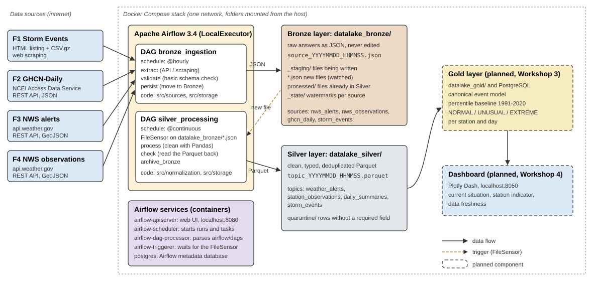
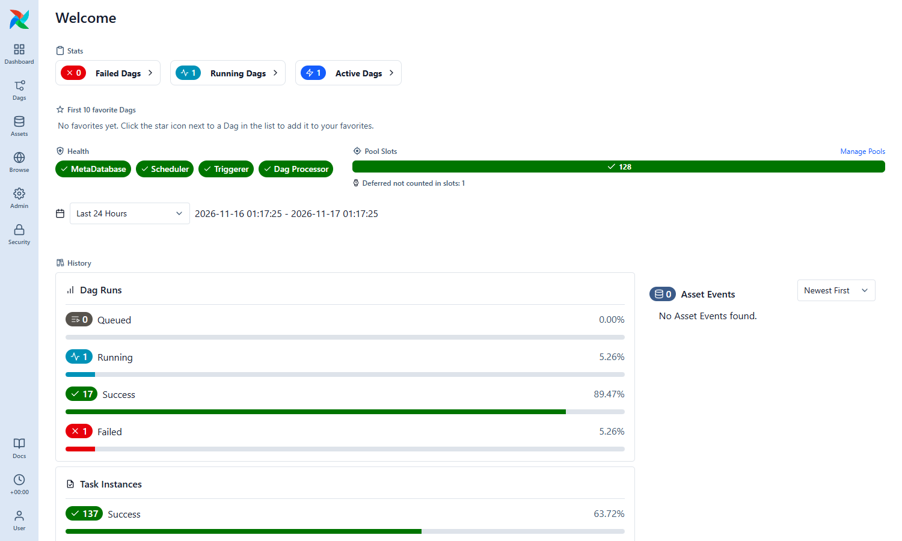
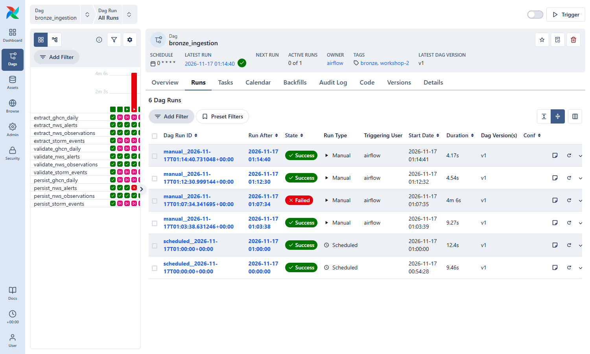
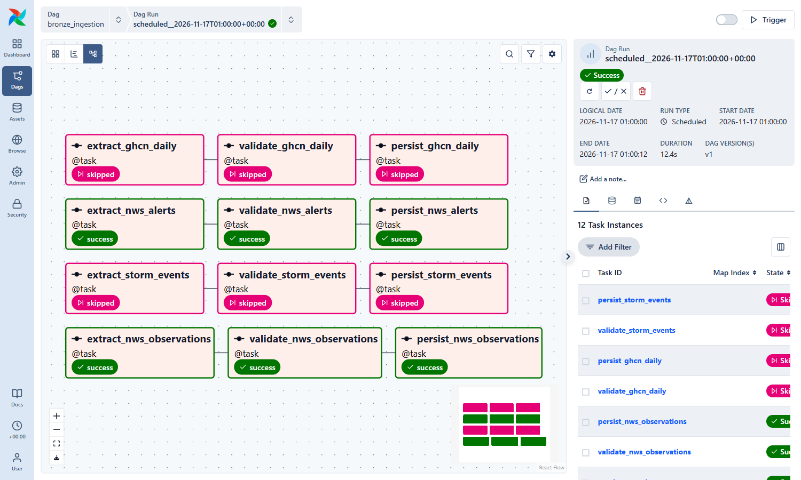
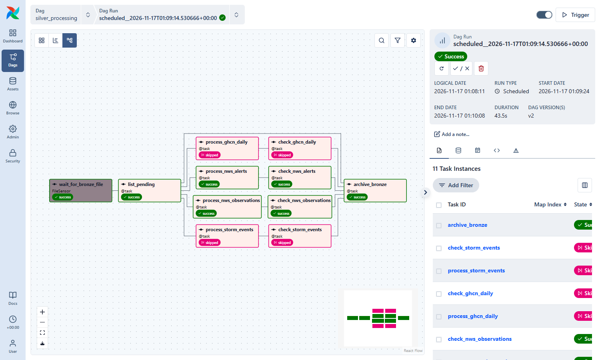
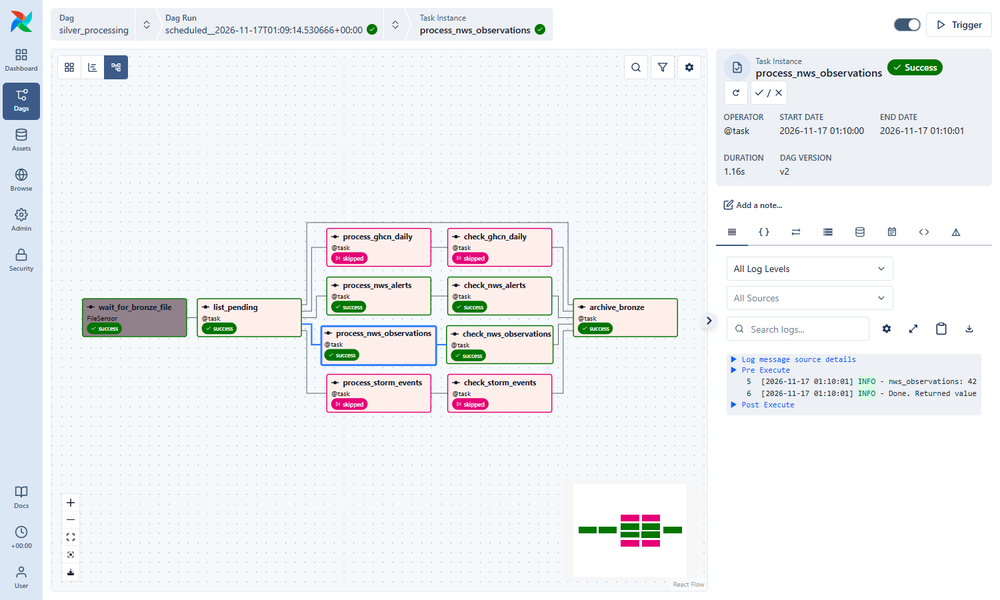

# Workshop 2 Report: Technical Architecture and Bronze/Silver Pipeline

**Project:** Extreme Weather Monitoring (Texas)<br>
**Team 5:** Andrés Mendoza, David Martínez, Juan Escallón<br>
**Course:** Data Analysis Programming 2026-II, Universidad Distrital. Prof. Carlos Andrés Sierra.<br>
**Repository:** https://github.com/UD4vyd/proyecto_Prog_data_analysis (branch `workshop-2`)

## 1. Executive summary

In Workshop 1 we chose four public NOAA sources and wrote the ingestion contract. In this workshop we
built the first working version of the pipeline. It runs on Apache Airflow 3.4 inside Docker Compose and
has two DAGs:

- `bronze_ingestion` runs every hour, asks the four sources and saves each answer as a raw JSON file in
  `datalake_bronze/`.
- `silver_processing` waits with a FileSensor for new files in `datalake_bronze/`, cleans them with
  Pandas and saves Parquet files in `datalake_silver/`.

On 2026-11-17 the Bronze DAG ran six times (five successful, one failed and explained in section 8) and
produced 15 Bronze files. The Silver DAG turned them into six Parquet files with 7,064 rows. The same
code also runs from the command line (`ingest.py`), which we used to load one full year of GHCN-Daily.

**How the workshop statement maps to our project.** The statement talks about one API source and one web
scraping target, and about text cleaning for NLP. Our project has four sources and its data are mostly
numbers, so we applied it this way:

| Statement | In this project |
|---|---|
| API source | F2 GHCN-Daily, F3 NWS alerts, F4 NWS observations (REST APIs) |
| Web scraping target | F1 Storm Events: we read the HTML file listing to find the file of each year |
| Text preprocessing | description of the F3 alerts and narrative of the F1 events |
| Outliers in numeric fields | temperature, precipitation and damage values |

The Course Project document also asks Workshop 2 for `python ingest.py --mode historical`. Section 6.3
shows that mode working on top of the same Bronze and Silver code.

## 2. Architecture



*Figure 1. Components, data flows and layers. Dashed boxes are planned for later workshops.*

| Component | Purpose | Technology | Input | Output |
|---|---|---|---|---|
| Data sources | Provide the data | NOAA NCEI and NWS public services | HTTP requests | JSON, GeoJSON, CSV.gz |
| Bronze DAG | Extract, check and store raw answers | Airflow TaskFlow, `requests`, BeautifulSoup | the four sources | one JSON file per source and run |
| Bronze layer | Keep what the sources sent, to allow re-processing | JSON files on a mounted folder | Bronze DAG | files watched by the Silver DAG |
| Silver DAG | Detect new files and clean them | Airflow FileSensor, Pandas, PyArrow | Bronze JSON | Parquet, quarantine rows |
| Silver layer | Clean, typed and deduplicated tables | Parquet files | Silver DAG | input of the Gold layer |
| Gold layer (planned) | Canonical event model and percentile indicator | PostgreSQL, PySpark | Silver Parquet | tables for the dashboard |
| Dashboard (planned) | Show the current situation to the analyst | Plotly Dash | Gold tables | web page on port 8050 |
| Airflow services | Schedule and run the tasks, show the UI | 4 Airflow containers and PostgreSQL | DAG files | runs, logs, task states |

The code is split so that the DAG files stay short. `src/sources/` has one client per source,
`src/normalization/` has one cleaning module per source, and `src/storage/` writes the Bronze and Silver
files. The DAGs and `ingest.py` only call these functions.

### 2.1 Technology choices

| Choice | Reason |
|---|---|
| Airflow with TaskFlow | Each step is a Python function with `@task`, retries and logs come from Airflow, and the UI shows which source failed. |
| LocalExecutor | Our tasks are short and run on one machine. The official compose file uses CeleryExecutor with Redis and a worker, which we do not need, so we removed them. |
| JSON for Bronze | Three sources already answer in JSON. For F1 (CSV) each row is stored with all its fields as text, so nothing is interpreted at this stage. |
| Pandas for Silver | A batch has between 40 and 6,000 rows, so it fits in memory, and the Workshop 1 notebook already used Pandas for the same data. Polars would be faster, but speed is not our problem at this size. |
| Parquet for Silver | It keeps the data types (UTC timestamps, categories, lists), it is compressed (5,641 storm events use 724 KB against 11.5 MB in JSON) and PySpark reads many files of a topic at once in Workshop 3. |
| Custom image | `Dockerfile` adds the libraries of `requirements.txt` to `apache/airflow:3.4.0`, so every container has the same versions. |

### 2.2 File names

| Layer | Pattern | Example |
|---|---|---|
| Bronze | `source_YYYYMMDD_HHMMSS.json` | `nws_observations_20261117_010000.json` |
| Silver | `topic_YYYYMMDD_HHMMSS.parquet` | `station_observations_20261117_010959.parquet` |

All times are UTC. In Bronze the timestamp is the time the run was scheduled for, so repeating a run
writes the same file name again. In Silver it is the time the processing run started. Sources are
`nws_alerts`, `nws_observations`, `ghcn_daily` and `storm_events`; topics are `weather_alerts`,
`station_observations`, `daily_summaries` and `storm_events`.

## 3. Preprocessing pipeline (Bronze to Silver)

Every rule below answers a problem we measured in Workshop 1 (`workshop_1/data_quality_issues.csv`) or
saw again in the Bronze files of this workshop. The steps are the same for the four sources:

1. Read the Bronze file and flatten each record into columns.
2. Convert data types and units.
3. Apply the null rules and the physical range check.
4. Clean the text fields.
5. Compute the outlier flags.
6. Enforce the target schema; rows without a required field go to `datalake_silver/quarantine/`.
7. Remove duplicates inside the batch and against earlier Silver files.
8. Write the Parquet file and read it back to check it.

### 3.1 Null handling

We do not impute measurements. A filled-in temperature would be an invented observation, and the goal of
the project is to decide whether a measured value is unusual. Nulls are kept, flagged or rejected:

| Field | What we observed | Strategy |
|---|---|---|
| F4 `windGust` | null in 97.7% of 88 observations: it is only reported when there are gusts | keep null |
| F4 `precipitationLastHour`, `precipitationLast3Hours` | null in every record of the sample (no rain) | keep null; null means "not reported", not 0 mm |
| F4 `seaLevelPressure` | null in 81.8%: only the hourly report has it | keep null, `pressure_hpa` is complete |
| F4 `temperature` | 2 nulls in 1,500 values in Workshop 1, with QC code `Z` | keep null, keep the QC code in `temperature_qc` |
| F2 `PRCP` | 2 nulls in 1,166 station-days | keep null |
| F2 values with an NCEI quality flag | none in our sample, but the flag exists | set the value to null and name the element in `qc_failed` |
| F2 trace precipitation | 142 days with `PRCP = 0.0` and flag `T` | keep 0.0 and set `is_trace = true` |
| F1 `DAMAGE_PROPERTY` | blank in 15.7% of 5,641 events | keep null: blank means unknown, and 0 would claim there was no damage |
| F1 coordinates | missing in all 2,069 zone rows | keep null; the event is located by zone |
| F3 `geometry` | missing in 77 of 169 alerts | keep null centroid, `has_geometry = false`, zones stay in `ugc_codes` |
| F3 `ends` | null in 30 of 169 alerts | keep null |
| F3 `severity`, `certainty`, `urgency` | categories defined by CAP | a missing value becomes the CAP value `Unknown` (sentinel) |
| F3 `headline`, `description` | text | a missing text becomes an empty string |
| Required fields (keys and main timestamp) | no case so far | the row is rejected and written to quarantine |

### 3.2 Data types and units

| Problem seen in the data | Rule in Silver |
|---|---|
| F2 numbers arrive as text (`"TMAX": "21.7"`) | `pd.to_numeric(errors="coerce")` to `float64` |
| F3 `sent` has local offsets (`-06:00`, `-07:00`) | parsed with the offset and stored as UTC datetime |
| F1 local standard time with a 2-digit year and a separate offset (`CST-6`) | built from `BEGIN_YEARMONTH`, `BEGIN_DAY`, `BEGIN_TIME`; UTC = local time + offset hours |
| F1 damage as text (`10.00K`, `1.5M`) | number in USD (K, M, B multipliers) |
| F1 `MAGNITUDE` unit depends on the event type | hail inches to mm, wind knots to m/s, with the unit in `magnitude_unit` |
| F4 values are `{value, unitCode, qualityControl}` objects | one column per variable; km/h to m/s, Pa to hPa. An unknown `unitCode` stops the task, so a unit change in the API cannot pass unnoticed |
| GeoJSON coordinates are `[lon, lat]` | stored as separate `latitude` and `longitude` columns |
| Repeated text values (event, severity, station, time zone) | `category` type |

### 3.3 Text preprocessing

F3 descriptions are bulletins such as `* WHAT...For the Coastal Flood Advisory, minor coastal flooding.`
with line breaks inside sentences. The rule is: lowercase, replace the `...` separators and all
punctuation by spaces, collapse line breaks and repeated spaces (`description_clean`), then split into
words and remove English stop words and one-letter tokens (`description_tokens`, `token_count`). The stop
word list is a fixed list in `src/normalization/text.py`, because the bulletins are plain English and a
language library would need a download inside the container. The original `description` is kept. The
example above becomes `coastal, flood, advisory, minor, coastal, flooding`. The same cleaning (without
tokens) is applied to the F1 event narrative.

### 3.4 Outliers

An extreme value is what this project looks for, so a statistical outlier is **flagged and never
removed**. Only values that are physically impossible are set to null.

| Check | Fields | Rule | Result in our files |
|---|---|---|---|
| Physical range | F4 variables, F1 coordinates | outside fixed limits (for example temperature outside -60 to 60 degC) the value becomes null and the column is named in `out_of_range` | 0 values |
| Z-score | F4 temperature per station | more than 3 standard deviations inside the batch, flag `temperature_outlier` | 0 flags in 88 rows |
| IQR | F2 TMAX and TMIN per station | outside Q1 - 1.5 IQR, Q3 + 1.5 IQR inside the batch | 37 TMAX and 1 TMIN flags in 1,166 days |
| IQR on wet days | F2 PRCP per station | quartiles computed only on days with rain | 18 flags |
| IQR on log10 | F1 property damage per event type | damage spans from 1 thousand to 200 million USD, so we use the logarithm | 57 flags |

For PRCP the quartiles use only wet days. Most days have no rain, so with all days Q1 and Q3 are 0 and
every rainy day would be an outlier. A limit of this first version: the IQR is computed on the batch,
without the season. In the 2025 load most TMAX flags are cold winter days, which are normal for January.
The real baseline (percentiles by day of year, 1991-2020) belongs to the Gold layer.

### 3.5 Deduplication

Batches overlap on purpose. Each F4 request re-reads 3 hours before the watermark, F3 returns the whole
7-day list every time and F2 re-reads 30 days. Silver removes the repetitions in two steps:

- Inside a batch, rows with the same key keep the one from the newest Bronze file.
- Against earlier Silver files, a row is dropped when its key and its `record_hash` (SHA-1 of the
  content columns) are already stored. If the source re-publishes a record with another value, the hash
  changes and the new version is written; the reader keeps the latest `processed_at` per key.

| Topic | Key | Bronze records | Silver rows |
|---|---|---|---|
| `weather_alerts` | `alert_id` | 1,014 in 6 files | 169 |
| `station_observations` | `icao`, `timestamp_utc` | 283 in 6 files | 88 |
| `daily_summaries` | `ghcn_id`, `date` | 1,166 in 2 files | 1,166 |
| `storm_events` | `event_id` | 5,641 in 1 file | 5,641 |

### 3.6 Target schema

Each topic has its schema in its module of `src/normalization/` (`SCHEMA`, `KEY`, `REQUIRED`). The
function `enforce_schema` creates missing columns as null, drops columns that are not in the schema and
converts the types. Every topic ends with four traceability columns: `record_hash`, `bronze_file`,
`ingested_at` and `processed_at`.

| Topic | Required fields | Main columns and types |
|---|---|---|
| `station_observations` (22 columns) | `icao`, `timestamp_utc` | `icao` category, `timestamp_utc` datetime UTC, `temperature_c`, `dewpoint_c`, `relative_humidity_pct`, `wind_speed_ms`, `wind_gust_ms`, `pressure_hpa`, `precip_1h_mm`, `precip_3h_mm` float, `temperature_qc` category, `out_of_range` string, `temperature_outlier` bool |
| `weather_alerts` (28 columns) | `alert_id`, `event`, `message_type`, `sent_utc` | `event`, `message_type`, `severity`, `certainty`, `urgency` category, five UTC datetimes, `ugc_codes` and `referenced_ids` list of strings, `centroid_lat`, `centroid_lon` float, `description_clean` string, `description_tokens` list, `token_count` int |
| `daily_summaries` (19 columns) | `ghcn_id`, `date` | `ghcn_id`, `icao` category, `date` date, `tmax_c`, `tmin_c`, `prcp_mm` float, `is_trace` bool, source flags string, `qc_failed` string, four bool flags |
| `storm_events` (26 columns) | `event_id`, `event_type`, `begin_utc` | `event_id` int, `event_type`, `cz_type`, `cz_timezone` category, `begin_utc`, `end_utc` datetime UTC, `begin_lat`, `begin_lon`, `magnitude`, `damage_property_usd`, `damage_crops_usd` float, `magnitude_unit` category, `narrative_clean` string, `damage_outlier` bool |

## 4. Docker stack

`docker-compose.yml` starts from the official Airflow 3.4.0 compose file. We changed the executor to
LocalExecutor, removed Redis, the Celery worker and Flower, and added our folders.

| Service | Image | Role |
|---|---|---|
| `postgres` | `postgres:16` | Airflow metadata database (runs, task states, XCom) |
| `airflow-init` | project image | runs once: database migration, admin user, folder permissions |
| `airflow-apiserver` | project image | web UI and REST API on `localhost:8080`. It is the service called "webserver" in Airflow 2 |
| `airflow-scheduler` | project image | starts the runs and executes the tasks (LocalExecutor) |
| `airflow-dag-processor` | project image | reads the files in `airflow/dags/`. In Airflow 3 it is a separate service |
| `airflow-triggerer` | project image | runs the wait of the FileSensor without using a task slot |

**Volumes.** `airflow/dags`, `airflow/logs`, `airflow/config` and `airflow/plugins` are mounted for live
DAG editing and logs. `datalake_bronze/`, `datalake_silver/` and `datalake_gold/` are mounted so the data
stay on the host when the containers are removed. `src/`, `config/` and `ingest.py` are mounted in
`/opt/airflow/project`, which is in `PYTHONPATH`, so the DAGs import the project code. A named volume
keeps the PostgreSQL data.

**Networking.** Compose creates one network. The Airflow containers reach the database by the name
`postgres` and the API server by `airflow-apiserver`. Only port 8080 is published to the host.

**Configuration.** Secrets are not in the repository. `.env` (ignored by git, template in
`.env.example`) has the Fernet key, the JWT secret, the admin user and the contact for the NWS
`User-Agent` header. The connection `fs_default` used by the FileSensor is defined with the environment
variable `AIRFLOW_CONN_FS_DEFAULT`.

**Setup.**

```
cp .env.example .env           # then fill FERNET_KEY and NWS_USER_AGENT
docker compose build           # image with requirements.txt
docker compose up -d           # starts the six services
```

Then open `http://localhost:8080` (user and password from `.env`, `airflow` by default) and turn on the
two DAGs. Figure 2 shows the UI with the four Airflow components healthy.



*Figure 2. Airflow UI on localhost:8080: metadata database, scheduler, triggerer and DAG processor healthy.*

## 5. DAG documentation

### 5.1 `bronze_ingestion`

| Property | Value |
|---|---|
| File | `airflow/dags/bronze_ingestion_dag.py` |
| Schedule | `@hourly`, `catchup=False`, one active run at a time |
| Retries | 2, with 2 minutes between attempts |
| Output | up to four files `datalake_bronze/source_YYYYMMDD_HHMMSS.json` |

The schedule comes from the Workshop 1 contract: F4 is polled every hour. F3 was planned every 15
minutes; in this first version it shares the hourly run, which loses no alerts because the API returns
the last 7 days each time. Each source has three tasks:

| Task | What it does |
|---|---|
| `extract_nws_alerts` (API) | F3: the 7-day alert list for Texas, following the pagination cursor, plus the ids of the alerts active now |
| `extract_nws_observations` (API) | F4: observations of each station from its watermark minus 3 hours, always with the `start` parameter |
| `extract_ghcn_daily` (API) | F2: last 30 days per station. Skipped if F2 was already ingested that day |
| `extract_storm_events` (scraping) | F1: parses the HTML listing with BeautifulSoup, finds the newest file of each year and downloads it only if its compilation date changed. Skipped otherwise |
| `validate_<source>` | basic schema check: envelope keys, record count, HTTP status 200 and required fields in every record |
| `persist_<source>` | moves the file from `_staging/` to `datalake_bronze/` and then advances the watermark |

A Bronze file is an envelope with the source, the run timestamp, the list of requests (URL, status, time,
ETag) and the records as received. Extract tasks write to `_staging/` and pass only the file path through
XCom. A file that fails validation stays in staging and never reaches the watched folder. The watermark
moves only after the file is in Bronze, as the Workshop 1 failure rule says.

**Error handling and logging.** The HTTP helper retries on timeouts and on status 429 and 5xx with a
growing wait, and raises after four attempts. Airflow then retries the task twice. Each task logs what
it did, for example `F4 KDFW: 25 observations since 2026-11-16T18:00:00Z`.

### 5.2 `silver_processing`

| Property | Value |
|---|---|
| File | `airflow/dags/silver_processing_dag.py` |
| Schedule | `@continuous`: when a run ends, the next one starts and waits |
| Trigger | `FileSensor` on `datalake_bronze/*.json` |
| Output | one file `datalake_silver/topic_YYYYMMDD_HHMMSS.parquet` per topic with new rows |

| Task | What it does |
|---|---|
| `wait_for_bronze_file` | FileSensor. Succeeds when at least one JSON file is in the top folder of `datalake_bronze/` |
| `list_pending` | lists the pending files by source and fixes the timestamp of the processing run |
| `process_<source>` | applies section 3 to the files of one source and writes the Parquet file. Skipped if the source has no pending files |
| `check_<source>` | reads the Parquet file back and checks the columns, the required fields and the unique key |
| `archive_bronze` | moves the processed files to `datalake_bronze/processed/`. Runs only if no source failed |

**FileSensor settings.** `poke_interval=30` is how often the sensor looks at the folder: a new file is
noticed in at most 30 seconds. `timeout=3600` is how long one run waits before giving up; we set it to
one hour because that is the period of the Bronze DAG. With `soft_fail=True` a run that sees no file in
that hour is marked as skipped, not failed. With `deferrable=True` the wait runs in the triggerer, so a
waiting run does not occupy a task slot.

**Why the files are moved.** The sensor only knows whether a file matches the pattern. If processed files
stayed in the folder it would fire all the time. After a successful run the folder is empty again, so the
sensor reacts only to new files. If a run fails, the files stay and the next run takes them.

**Traceability.** Each row has `bronze_file`, `ingested_at` and `processed_at`, and the Parquet metadata
has the list `bronze_files` of the run.

### 5.3 Idempotency

- Re-running a Bronze run writes the same file name, because the name uses the scheduled time.
- F2 and F1 are skipped when there is nothing new (same day, same compilation date).
- Processing the same Bronze file twice adds no rows to Silver, because of the key and hash check.
  We tested it: we deleted the Silver files and re-processed the 11 Bronze files that existed at that
  moment, run by run, and got the same row counts.
- A watermark never moves back, so a historical load of old years does not hide recent data.

## 6. Results

### 6.1 DAG runs



*Figure 3. Runs of `bronze_ingestion`: two scheduled and four manual. The failed run is explained in section 8.*



*Figure 4. Bronze run of 01:00 UTC. F3 and F4 succeed; F2 and F1 are skipped because the first run of the day already ingested them.*



*Figure 5. A Silver run: the FileSensor detects the files, two sources are processed and checked, and the Bronze files are archived.*

| Bronze run (UTC) | Type | Files written | Result |
|---|---|---|---|
| 2026-11-17 00:00 | scheduled | alerts 169, observations 85, daily 71, storm events 5,641 records | success |
| 2026-11-17 01:00 | scheduled | alerts 169, observations 42 | success, F2 and F1 skipped |
| 2026-11-17 01:03 | manual | alerts 169, observations 39 | success |
| 2026-11-17 01:07 | manual | alerts 169, observations 39 | failed in `persist_nws_alerts` |
| 2026-11-17 01:12 | manual | alerts 169, observations 39 | success |
| 2026-11-17 01:14 | manual | alerts 169, observations 39 | success |

### 6.2 Sample Bronze file

`datalake_bronze/processed/nws_observations_20261117_000000.json` (shortened):

```
{"source": "nws_observations", "run_stamp": "20261117_000000",
 "extracted_utc": "2026-11-17T00:54:31+00:00", "record_count": 85,
 "requests": [{"url": "https://api.weather.gov/stations/KDFW/observations?start=2026-11-16T18%3A00%3A00Z",
               "status": 200, "retrieved_utc": "2026-11-17T00:54:31+00:00", "records": 25}, ...],
 "state": {"KDFW": "2026-11-16T23:55:00+00:00", "KIAH": "2026-11-17T00:20:00+00:00", ...},
 "records": [{"geometry": {"type": "Point", "coordinates": [-97.03, 32.9]},
   "properties": {"stationId": "KDFW", "timestamp": "2026-11-16T23:55:00+00:00",
     "temperature": {"unitCode": "wmoUnit:degC", "value": 13, "qualityControl": "V"},
     "windSpeed": {"unitCode": "wmoUnit:km_h-1", "value": 5.544, "qualityControl": "V"},
     "windGust": {"unitCode": "wmoUnit:km_h-1", "value": null, "qualityControl": "Z"},
     "barometricPressure": {"unitCode": "wmoUnit:Pa", "value": 102776.9, "qualityControl": "V"}, ...}}]}
```

### 6.3 Silver files

| Silver file | Rows | Size | Bronze file it comes from |
|---|---|---|---|
| `weather_alerts_20261117_010918.parquet` | 169 | 116 KB | `nws_alerts_20261117_000000.json` |
| `station_observations_20261117_010918.parquet` | 85 | 19 KB | `nws_observations_20261117_000000.json` |
| `station_observations_20261117_010959.parquet` | 3 | 14 KB | `nws_observations_20261117_010000.json` |
| `daily_summaries_20261117_010918.parquet` | 71 | 15 KB | `ghcn_daily_20261117_000000.json` |
| `daily_summaries_20261117_011045.parquet` | 1,095 | 63 KB | `ghcn_daily_20261117_010334.json` |
| `storm_events_20261117_010918.parquet` | 5,641 | 724 KB | `storm_events_20261117_000000.json` |

The second observations file has only 3 rows: the 01:00 run brought 42 observations, 39 of them were
already in Silver from the overlap window, and one new report per station was left. The later runs
brought no new observation or alert, so they wrote no Silver file. The file
`daily_summaries_20261117_011045.parquet` comes from the historical load of 2025:

```
docker compose exec airflow-scheduler python /opt/airflow/project/ingest.py \
    --mode historical --source ghcn_daily --start-year 2025 --end-year 2025 --skip-silver
```

The same observation as in section 6.2 after cleaning (`station_observations`, selected columns):

| icao | timestamp_utc | temperature_c | wind_speed_ms | wind_gust_ms | pressure_hpa | temperature_qc | bronze_file |
|---|---|---|---|---|---|---|---|
| KDFW | 2026-11-16 23:55:00+00:00 | 13.0 | 1.54 | null | 1027.769 | V | nws_observations_20261117_000000.json |

Wind went from 5.544 km/h to 1.54 m/s and pressure from 102,776.9 Pa to 1,027.769 hPa. The notebook
`notebooks/02_silver_exploration.ipynb` reads these files with Pandas and shows types, traceability,
null percentages and a plot of the station temperature.



*Figure 6. Log of `process_nws_observations` in the Airflow UI.*

## 7. What changed from Workshop 1

Building the pipeline showed some statements of our Workshop 1 report that needed correction:

- **ETag of the alert list.** Workshop 1 concluded that the ETag changes without new alerts. That is
  true for `/alerts/active`: its ETag took five different values in six polls with the same six alerts. The
  ETag of `/alerts?area=TX` is the opposite case: it has been the same value since our first poll on
  2026-11-16, while the list went from 172 to 169 alerts. So neither ETag can detect changes, and the
  pipeline compares alert ids.
- **F4 default answer.** In Workshop 1 one station was answered from a cache with an old list. All F4
  requests now send `start`, computed from the watermark.
- **Request metadata.** Workshop 1 said every raw file had its headers file, but the reference files of the
  station selection did not. Now each Bronze file carries the URL, status, time and ETag of all its requests.
- **PRCP statistics.** They are computed on wet days only (section 3.4).
- **Repository.** The large reference files (52 MB) are no longer committed; the README says where to
  download them.

## 8. Challenges and decisions

| Challenge | What happened | Decision |
|---|---|---|
| Two tasks writing one state file | In the 01:07 run, `persist_nws_alerts` and `persist_nws_observations` ran at the same time. One read `watermarks.json` while the other was writing it and failed with a JSON error. The retries also failed, because the file had already left staging. | One state file per source, written to a temporary file and renamed. `persist` now continues if the file is already in Bronze. The runs after the fix succeeded. |
| FileSensor fires on old files | With the first design the sensor was true whenever any JSON existed. | Processed files are moved to `processed/`, and files are written in `_staging/` and renamed, so the sensor only sees complete new files. |
| Timestamp of the Silver file | We first used the logical date of the run. With `@continuous` that date is the previous run, so files had a wrong time. | `list_pending` takes the time once and shares it with the other tasks through XCom. |
| A column added after the first runs | We added `precip_3h_mm` when we saw the API has `precipitationLast3Hours`. Files written before had another schema and other hashes. | We deleted Silver and re-processed all Bronze files. This is the reason to keep Bronze unchanged. |
| New DAG files not detected | Airflow 3 took several minutes to list new files in `airflow/dags/`. | Restart `airflow-dag-processor` after adding a DAG file. Changes to existing files are read in seconds. |
| Size of the F1 Bronze file | Texas 2025 is 11.5 MB as JSON. | The file is ignored by git and rebuilt by the DAG. The Silver file (724 KB) is committed. |
| Data in XCom | Passing the records between tasks would store megabytes in the Airflow database. | Tasks pass file paths only. |

**Limits of this version.** It polls 3 of the 46 stations (setting `stations` in `config/pipeline.yaml`).
The historical load was run for one year of F2 and one year of F1, not for the whole windows (1991 and
1996). Loading Silver into the PostgreSQL canonical model of Workshop 1 is the next step. F3 is polled
hourly and not every 15 minutes.

## 9. References

- Apache Airflow 3.4 documentation: TaskFlow, FileSensor, Running Airflow in Docker.
  https://airflow.apache.org/docs/apache-airflow/stable/
- Apache Parquet documentation. https://parquet.apache.org/docs/
- The pandas development team. pandas documentation. https://pandas.pydata.org/docs/
- Apache Arrow. PyArrow documentation. https://arrow.apache.org/docs/python/
- Richardson, L. Beautiful Soup documentation. https://www.crummy.com/software/BeautifulSoup/bs4/doc/
- Docker Inc. Docker Compose documentation. https://docs.docker.com/compose/
- OASIS. Common Alerting Protocol Version 1.2. http://docs.oasis-open.org/emergency/cap/v1.2/CAP-v1.2-os.html
- NOAA National Centers for Environmental Information. Storm Events Database.
  https://www.ncei.noaa.gov/stormevents/
- Menne, M. J., et al. (2012). Global Historical Climatology Network - Daily (GHCN-Daily), Version 3.
  NOAA National Climatic Data Center. doi:10.7289/V5D21VHZ
- National Weather Service. API Web Service documentation.
  https://www.weather.gov/documentation/services-web-api
