# Workshop 3 Report: Pipeline Improvements, Gold Layer with PySpark and Storytelling Definition

**Project:** Extreme Weather Monitoring (Texas) 
**Team 5:** Andrés Mendoza, David Martínez, Juan Escallón 
**Course:** Data Analysis Programming 2026-II, Universidad Distrital. Prof. Carlos Andrés Sierra. 
**Repository:** https://github.com/UD4vyd/proyecto_Prog_data_analysis (branch `w3`)

## 1. Executive summary

In Workshop 2 we built the Bronze and Silver layers on Apache Airflow 3.4 in Docker Compose. In this
workshop we looked closely at what those layers really produced, fixed what we found, and added the Gold
layer:

- **Data quality review.** A pandas notebook (`notebooks/03_data_quality_findings.ipynb`) reviewed every
    Silver file and found eight issues we had not anticipated. The largest: 67 % of the 2025 Storm Events rows in
  Silver were copies of unchanged records, the GHCN-Daily history was missing the 1991-2020 baseline that our
  indicator needs and ten months of 2026, and Storm Events only had one year instead of the five the Course
  Project asks for.
- **Pipeline improvements.** The Silver record hash now covers only source values, Silver recomputes the hash
  of stored records with the current rule, the text cleaning removes links and bulletin noise, the Bronze HTTP
    client follows `Retry-After`, and historical loads filled the gaps: GHCN-Daily 1991-2024 and 2026, Storm
  Events 2021-2024.
- **Gold layer.** A new DAG, `gold_processing`, runs PySpark in local mode inside the Airflow containers once a
  day. It reads all the Silver files of each topic as one DataFrame and writes two Parquet files:
  `governance_YYYYMMDD_HHMMSS.parquet` (12 data quality KPIs) and `storytelling_YYYYMMDD_HHMMSS.parquet`
    (11 aggregations for the functional dashboard). The final run took 1 min 38 s.
- **Story.** Compared with their own 1991-2020 history, the three stations had a warm 2021-2026: 15 % of the
  days had an unusually high maximum temperature (10 % expected) and 2.1 % an extreme one (1 % expected), with
  23.7 % in 2023. Days we label EXTREME have a Storm Events report in the station county or zone 16.6 % of the
  time, against 3.5 % for normal days, at all three stations.

**How the workshop statement maps to our project.** The statement is written for opinion data (sentiment,
public opinion). Our texts are official weather bulletins without opinion, so we kept the structure and changed
the measure:

| Statement | In this project |
|---|---|
| Sentiment (positive / neutral / negative) | station-day class NORMAL / UNUSUAL / EXTREME against 1991-2020, and CAP alert severity Minor 1 to Extreme 4 |
| Sentiment trend over time | alerts and mean severity score per local day; class distribution per month |
| Top keywords and n-grams | words and bigrams of alert descriptions and Storm Events narratives |
| Keyword sentiment association | mean severity of the alerts that contain each top keyword |
| Source comparison (API vs scraping) | F2, F3, F4 (APIs) against F1 Storm Events (web scraping of the file listing) |
| Topic breakdown | alerts per event type, storm impacts per event type |
| Language distribution | not applicable: every text is an English NWS or NCEI bulletin |

## 2. Data quality findings

All findings come from the Silver files that existed on 2026-11-20 (4 topics, 27 files) and from the names of
the Bronze files. The notebook computes every number; the tables below summarise them.

| # | Field / topic | Issue | Frequency / severity | Handling | KPI |
|---|---|---|---|---|---|
| 1 | all topics | four different schemas in one folder | high for Spark | read one topic at a time; check every file against the target schema | schema compliance |
| 2 | storm_events, daily_summaries | unchanged records written again in every run | 11,288 of the 16,935 rows of the 2025 F1 file (66.7 %) | hash on source values; Gold keeps the latest version | duplicate rate |
| 3 | F4 wind gust, precipitation, sea-level pressure; F1 coordinates and magnitude; F3 polygon | mostly null | 83-100 % (F4), 48-53 % (F1), 64 % (F3) | keep null (not reported), never fill with zero | null rate per field |
| 4 | daily values, storm damage | extreme values | 2 % of wet days, under 1 % of temperatures, 1 % of damages | flag, never remove (Harvey: 408 mm) | outlier rate |
| 5 | alert descriptions, storm narratives | links and time words as tokens; empty narratives | 46 alerts with a link; 20.1 % empty narratives | link and noise removal | text length |
| 6 | F3, F4 ingestion | days without hourly runs | 0 of 24 runs on 2026-11-18 | documented; Docker on while working | ingestion compliance, freshness |
| 7 | F2 and F1 history | no 1991-2024 baseline, January-October 2026 missing, KAUS gaps in 1991-1997; F1 with only 2025 | indicator impossible; F1 below the five-year minimum | historical loads, `baseline_n` per class | station completeness, volume |
| 8 | F3 status | a Test message with severity Extreme | 1 of 264 alerts | Gold uses `status = Actual` | alert status |

**Finding 1, schema.** Every file of a topic has the same columns and types (27 of 27 files), so the cloud
folder pattern works per topic. The four topics share one folder but have different schemas; reading the whole
folder as one DataFrame would keep the schema of one file and drop the columns of the others.

**Finding 2, duplicates.** Silver skips a record when the same key and the same content hash are already
stored. The 2025 Storm Events file was still stored three times, once per NOAA compilation
(`_c20260819`, `_c20261118`, `_c20261119`). The hash included the source file name, which changes with every
compilation, and the outlier flags, which are computed on the whole batch. Recomputing the hash on the same
rows without those columns gives 29,104 versions for 29,051 events (2021-2025): 53 events of 2025 that NOAA
really revised, and 11,235 copies that should never have been written. The three daily duplicates disappear for the same reason.

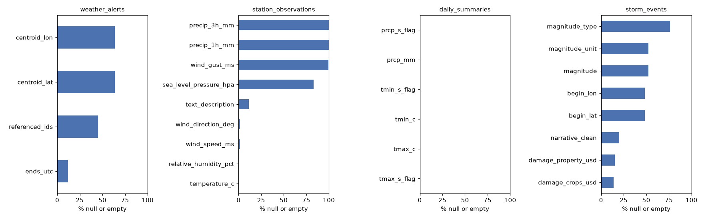
*Figure 1. Null or empty values per field (latest version of each record).*

**Finding 3, nulls.** The NWS API sends some F4 fields with `value: null` at our stations: wind gust (99.6 %),
precipitation of the last 1 and 3 hours (100 %) and sea-level pressure (83 %). These columns cannot feed a chart;
precipitation comes from F2. In F1, about half of the rows are forecast zones without coordinates (drought,
heat and winter events are reported by zone), and magnitude only exists for hail and wind. Two thirds of the F3 alerts are zone-based and have no polygon.

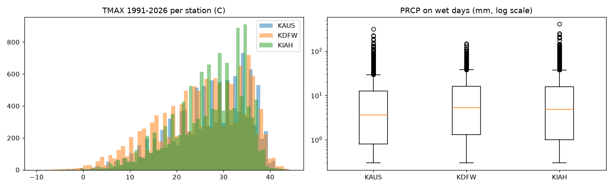
*Figure 2. TMAX distribution per station and precipitation on wet days (log scale).*

**Finding 4, outliers.** No F4 value broke the physical limits. NCEI quality flags removed only two daily
values (KAUS, March 1999). The largest precipitation, 408 mm at KIAH on 2017-08-27, is Hurricane Harvey.
For this project an extreme value is the signal, so outliers stay in the data with a flag.

**Finding 5, text.** Alert descriptions have a median of 427 characters after cleaning; 20.1 % of storm
narratives are empty (mostly Hail, High Wind and Heat). Before the fix, `cst` and `pm` were among the most frequent alert
tokens, and 46 descriptions contained a link such as `http://www.weather.gov/safety/flood`, which became the
tokens `http`, `www` and `gov`.

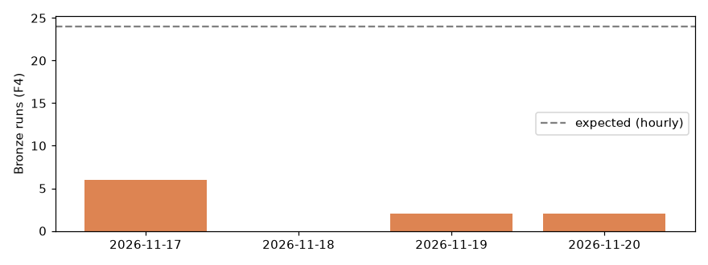
*Figure 3. Hourly Bronze runs per day (24 expected).*

**Finding 6, ingestion.** The Bronze DAG is hourly, but our stack runs on a laptop. On 2026-11-18 there was no
run at all. The NWS API keeps about seven days and only answers with current data, so those hours are lost.

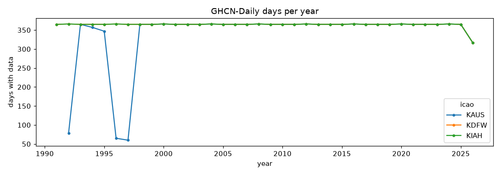
*Figure 4. GHCN-Daily days per year and station after the historical loads.*

**Finding 7, completeness.** The first Gold test showed that F2 only had 2025 and the last 35 days of 2026: the
Workshop 2 historical load covered one year, and the incremental extraction looks only 30 days back. Without
1991-2020 the indicator of Workshop 1 cannot be computed. After loading 1991-2024 and 2026 the history has
38,018 station-days. KAUS (Austin-Bergstrom) starts on 1992-10-15 and has only 65 and 60 days in 1996 and
1997, so its 1991-2020 baseline has 26 complete years instead of 30.

F1 had the same kind of gap: only the 2025 file was loaded, while the Course Project asks for at least five
years of each historical source where available, and NOAA publishes Storm Events since 1996. The historical load
of 2021-2024 added 23,404 Texas events (5,414 to 7,689 per year), and the Bronze DAG now checks the five year
files for new compilations (`config/pipeline.yaml`).

**Finding 8, test messages.** One alert of the Texas feed is a TEST Tsunami Warning (severity Extreme) of the
National Tsunami Warning Center. It is a valid CAP message with `status = Test`; counted as weather, it would be
the only Extreme alert of the period.

A smaller observation: GHCN-Daily stores whole degrees Fahrenheit, so in Celsius the values move in steps of
about 0.56 degrees and often repeat for several days (38.3 C is 101 F). This is the resolution of the source.

## 3. Pipeline improvements

| Area | Observed (before) | Change (after) | Why |
|---|---|---|---|
| Silver record hash | hash over every content column, including `source_file`, outlier flags and cleaned text | each normalizer declares `HASH_EXCLUDE`; the hash covers only source values (`src/normalization/common.py`) | a new compilation or a new batch must not look like a new version of every record |
| Silver duplicate check | compares with the `record_hash` stored in old files | recomputes the hash of stored records with the current rule (`src/storage/silver.py`) | after the change above, stored and new hashes no longer matched (section 8) |
| Alert centroid | mean of the polygon vertices with full float precision | rounded to 5 decimals and left out of the hash | the last digit changed between two answers for the same alert |
| Text cleaning | punctuation removal only | links and e-mail addresses removed; time zones, am/pm, weekdays, link fragments and numbers dropped from tokens (`src/normalization/text.py`) | noise tokens in the keyword ranking |
| Bronze HTTP client | fixed wait of 5, 10, 15 s between attempts | follows `Retry-After` on 429 and 503, capped at 120 s (`src/sources/http.py`) | the NWS documentation asks clients to respect it |
| F2 history | 2025 plus the last 30 days | historical loads 1991-2024 and 2026 with `ingest.py --mode historical` | the indicator needs the 1991-2020 baseline |
| F1 history | 2025 only | historical load 2021-2024; `storm_events.years` set to 2021-2025 | at least five years per historical source (Course Project) |
| Gold alert filter | n/a | only `status = Actual`, without Cancel messages | finding 8 |
| Docker image | Airflow and Python libraries | plus OpenJDK 21 (`default-jre-headless`), `JAVA_HOME` and PySpark 4.3 | Spark runs on the JVM |

The effect of the hash change was measured on the real files: the 2025 Storm Events rows go from 16,935
versions to 5,700,
and the GHCN-Daily rows written before the historical loads from 1,201 to 1,198 (their number of keys).
A new test (`tests/test_pipeline.py::test_second_processing_writes_nothing`) processes the same Bronze answer
twice and checks that the second time writes nothing.

The files written before the fix keep their copies. We did not rewrite Silver history; Gold reads every file and
keeps the latest version of each key, and the duplicate rate KPI shows the difference before and after.

## 4. Governance KPIs

Every KPI is computed with PySpark on the latest version of each record (except volume and duplicates, which
need the raw rows) and stored in `governance_YYYYMMDD_HHMMSS.parquet`.

| KPI (`section`) | Computation | Justification |
|---|---|---|
| `volume_daily`, `volume_total` | rows per topic and UTC day of ingestion, running total; files, raw rows, distinct keys, rows after de-duplication | base of every other rate; shows the historical loads as peaks |
| `duplicate_rate` | (raw rows - distinct keys) / raw rows, before and after Gold de-duplication | finding 2: 66.7 % of the 2025 Storm Events rows |
| `null_rate` | % of null, NaN, blank text or empty list per column | finding 3; columns where empty means "no problem" (`out_of_range`, `qc_failed`) are left out |
| `schema_compliance` | % of files whose columns equal the target schema of the normalizer; % of rows with every required field | finding 1; preventive, today 100 % |
| `outlier_rate` | % of rows flagged by each Silver check (IQR, Z-score, physical range, NCEI quality flag, TMIN above TMAX), overall and per station | finding 4 |
| `text_length`, `text_length_daily` | mean, median, min, max and empty share of the cleaned text length; daily mean | finding 5 |
| `ingestion_compliance` | distinct hourly runs per UTC day (from the Bronze file name of each Silver row) against 24 expected; days without runs appear with 0 | finding 6 |
| `freshness` | hours since the last ingestion of each topic | finding 6 and user story 5 |
| `station_completeness` | % of calendar days present and % of nulls per element, per station and year | finding 7 and user story 6 |
| `alert_status` | alerts per CAP status and message type | finding 8 |

Results of the final run (2026-11-20 16:44 UTC):

| Topic | Silver files | Raw rows | Distinct keys | Duplicate rate before | After |
|---|---|---|---|---|---|
| weather_alerts | 8 | 466 | 264 | 43.35 % | 0 % |
| station_observations | 9 | 1,419 | 1,362 | 4.02 % | 0 % |
| daily_summaries | 6 | 38,124 | 38,018 | 0.28 % | 0 % |
| storm_events | 4 | 40,339 | 29,051 | 27.98 % | 0 % |

All the Storm Events duplicates are copies of the 2025 file (11,288 rows); the 2021-2024 file loaded after
the fix has none. The duplicates of alerts, observations and daily summaries were written on 2026-11-20 between the hash change
and the re-hash fix (section 8): records of the overlap windows came back with the new hash and did not match
the stored one. Ingestion compliance was 21 % on 2026-11-17, 0 % on 2026-11-18, 8 % on 2026-11-19 and 12 % on
2026-11-20 at the time of the run.

## 5. Storytelling summary

**Narrative.** *How unusual is the weather at our Texas stations compared with their own 1991-2020 history,
when does the National Weather Service warn about it, and do our EXTREME days match real storm impacts?*
The functional user, a weather risk analyst, should leave the dashboard knowing (1) whether today is normal at
each station and whether an official alert covers it, (2) that recent days lean to the warm side of the
baseline, and (3) that EXTREME days carry more storm reports than normal days, so the indicator is worth
watching.

The indicator is the one proposed in Workshop 1: for each station, element (TMAX, TMIN, PRCP) and day of year,
percentiles p1, p10, p90 and p99 of the 1991-2020 values within +/-7 days (about 450 values). A day is NORMAL
inside p10-p90, UNUSUAL outside it and EXTREME outside p1-p99. Precipitation only has the high side.

| Aggregation (`section`) | Content | User story (Workshop 1) | Dashboard element |
|---|---|---|---|
| `station_day_class` | value, class and p1/p10/p90/p99 of every station-day since 2021-01-01, with `baseline_n` | US3 | band chart per station and element |
| `class_distribution` | days and % per class, station, element and month | US3 | stacked bars per month |
| `current_situation` | latest observation per station (temperature, dew point, humidity, wind, pressure, position) and the active alerts on its forecast zone or county | US2, US4 | map and KPI cards |
| `alert_severity_daily` | alerts per local day and severity, mean severity score | US1 | stacked bars and trend line |
| `alert_event_breakdown` | alerts per event type and severity, mean severity per type | US1 | bar chart |
| `top_keywords` | 25 words and 15 bigrams of alert descriptions and of storm narratives | US1 | word bars |
| `keyword_severity` | mean severity of the alerts that contain each top keyword | US1 | dot plot |
| `source_comparison` | records and covered period per source, API or web scraping | US5 | table |
| `storm_impact_by_type` | events, deaths, injuries and damage per Storm Events type | US7 | bar chart |
| `storm_monthly_volume` | storm reports per month and type | US7 | area chart |
| `extreme_vs_storms` | per station and class: station-days and % with a Storm Events report in the station county or zone on the same local day | US7 | grouped bars |

**Key results.**

| Element | NORMAL | UNUSUAL high | EXTREME high | UNUSUAL low | EXTREME low |
|---|---|---|---|---|---|
| TMAX (6,429 station-days) | 75.4 % | 15.4 % | 2.1 % | 5.9 % | 1.1 % |
| TMIN (6,429 station-days) | 79.7 % | 13.2 % | 2.1 % | 4.0 % | 0.9 % |
| PRCP (6,427 station-days) | 90.9 % | 8.3 % | 0.9 % | - | - |

By construction of the percentiles, 10 % of days should be above p90 and 1 % above p99. Maximum and minimum
temperatures were above both thresholds more often, and below them less often. The share of days with an
unusually or extremely high TMAX was 8.7 % in 2021, 18.4 % in 2022, 23.7 % in 2023, 15.3 % in 2024, 17.5 % in
2025 and 22.2 % in 2026 (to 13 November). The indicator also finds the known cold extreme: from 11 to 20
February 2021 (winter storm Uri) all three stations have EXTREME_LOW days (38 station-days).

| Class of the station-day (2021-2025) | Station-days | With a storm report in the county or zone |
|---|---|---|
| EXTREME | 331 | 16.6 % |
| UNUSUAL | 1,863 | 9.7 % |
| NORMAL | 3,284 | 3.5 % |

The pattern holds at every station: EXTREME against NORMAL days is 24.5 % against 4.4 % at KDFW, 14.4 %
against 3.4 % at KAUS and 11.1 % against 2.7 % at KIAH. With only 2025, KIAH had shown 0 % (32 EXTREME days),
which is why loading five years of Storm Events mattered for the story. Over 2021-2025, hail caused the largest
damage in Texas (6,918 reports, USD 3.1 billion) and flash floods the most direct deaths (158, of which 116 in
Kerr County in July 2025). Among the alert types with more than ten alerts, Flood Warning has the highest mean
severity (2.86). Keywords of advisories (`advisory`, `coastal`, `water`) have the lowest mean severity (1.3 to 1.5).

## 6. PySpark implementation

**Spark session** (`src/gold/spark.py`):

| Setting | Value | Reason |
|---|---|---|
| master | `local[*]` | driver and executors in the task process, one thread per core (12 in our VM) |
| `spark.driver.memory` | 2g (env `SPARK_DRIVER_MEMORY`) | enough for about 80,000 Silver rows; the Docker VM has 7.6 GB for all services |
| `spark.sql.shuffle.partitions` | 8 | the default 200 creates tiny tasks for small data |
| `spark.sql.session.timeZone` | UTC | every Silver timestamp is UTC; local days use `from_utc_timestamp(..., "America/Chicago")` |
| `spark.ui.enabled`, `spark.ui.showConsoleProgress` | false | the UI is unreachable in the container, and the progress bar went to stderr, which Airflow logs as ERROR |
| `PYSPARK_PYTHON` | the driver interpreter | on Windows the workers found the Store `python` alias |

**Docker adjustments.** The Dockerfile installs `default-jre-headless` (OpenJDK 21 in Debian 13) as root and sets
`JAVA_HOME=/usr/lib/jvm/default-java`; PySpark comes from `pyproject.toml` like every other dependency. The
`datalake_gold/` volume and the `GOLD_DIR` variable already existed in `docker-compose.yml`, so it did not change.

**Reading pattern.** Each topic is read with
`spark.read.option("pathGlobFilter", "<topic>_*.parquet").parquet("datalake_silver/")`, the folder pattern of a
cloud bucket. The filter keeps one schema per DataFrame. A first version used a glob inside the path
(`datalake_silver/<topic>_*.parquet`); it worked, but Spark printed a FileNotFoundException stack trace in every
task log while it looked for a `_spark_metadata` folder. `latest_version` then keeps one row per key with a
window function ordered by `ingested_at`.

**DAG** (`airflow/dags/gold_processing_dag.py`):

    check_silver -> build_governance -> build_storytelling -> check_gold

- schedule `15 6 * * *`: 06:15 UTC is 00:15 in Texas, when the local day that just ended is complete; `catchup=False`
  because every run reads the whole Silver layer.
- `check_silver` counts the files per topic, fails if one is missing and fixes the timestamp both files share.
- The two build tasks run one after the other on purpose: each starts a 2 GB driver, and the hourly Bronze and
  Silver runs share the same VM. PySpark is imported inside the tasks, so parsing the DAG does not start a JVM.
- `check_gold` reads both files back with pyarrow and checks the columns and that every expected section has rows.

**Key transformations.**

- *Baseline percentiles.* Each 1991-2020 value is copied to the 15 days of year it belongs to
  (`explode` of the offsets -7..+7 with `pmod` around the year end), then `percentile_approx` computes
  p1/p10/p90/p99 per station, element and day of year. 29 February shares the index of 28 February.
- *Melting.* The three daily elements become rows with `explode(array(struct(...)))`.
- *Keywords.* Tokens are recomputed from the cleaned text with `split`, a higher-order `filter` and the stop and
  noise word lists of Silver; bigrams come from `pyspark.ml.feature.NGram`.
- *Active alerts on a station.* `explode(ugc_codes)` joined with the forecast zone and county of each station.
- *Storm match.* Storm reports joined to stations by county (`cz_type = C`) or forecast zone (`cz_type = Z`)
  FIPS and local day; each station-day takes its strongest class over the three elements.

**Gold layout.** Both files share one long layout, so each holds many KPIs in one Parquet file and the dashboard
filters by section: `section, topic, period (date), dim_1, dim_2, metric, value (double), label, computed_at`.
Spark writes one part file to a hidden temporary folder (`coalesce(1)`) that is renamed to
`<name>_YYYYMMDD_HHMMSS.parquet`, so a reader never sees a half-written file.

**Tests.** `tests/test_gold.py` checks the latest-version rule, the five classes against known percentiles, the
leap-day index and the Test-message filter on small in-memory DataFrames (19 tests in total pass).

## 7. Results evidence

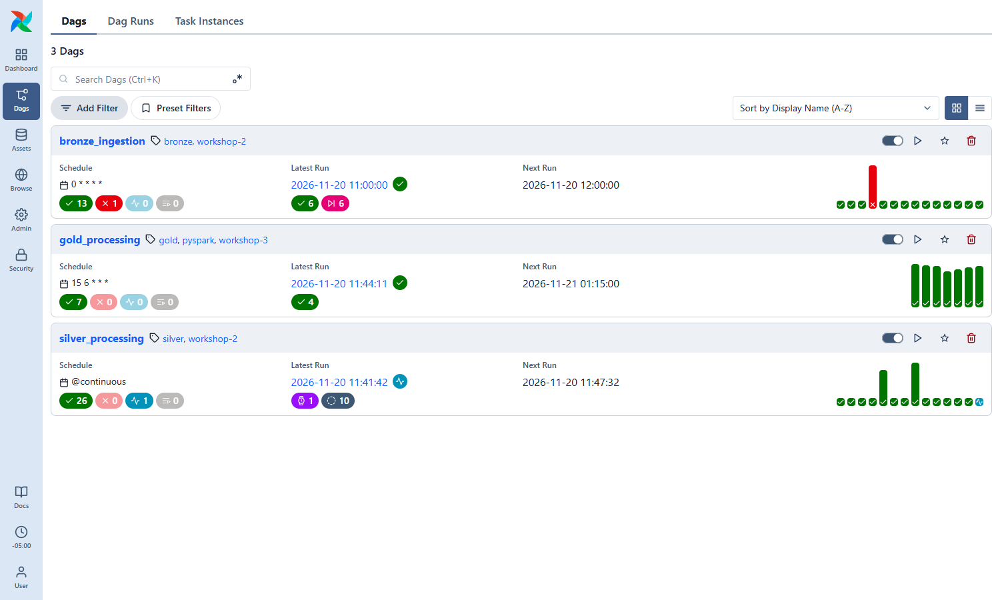
*Figure 5. The three DAGs of the pipeline. The failed Bronze run is the one explained in the Workshop 2 report.*

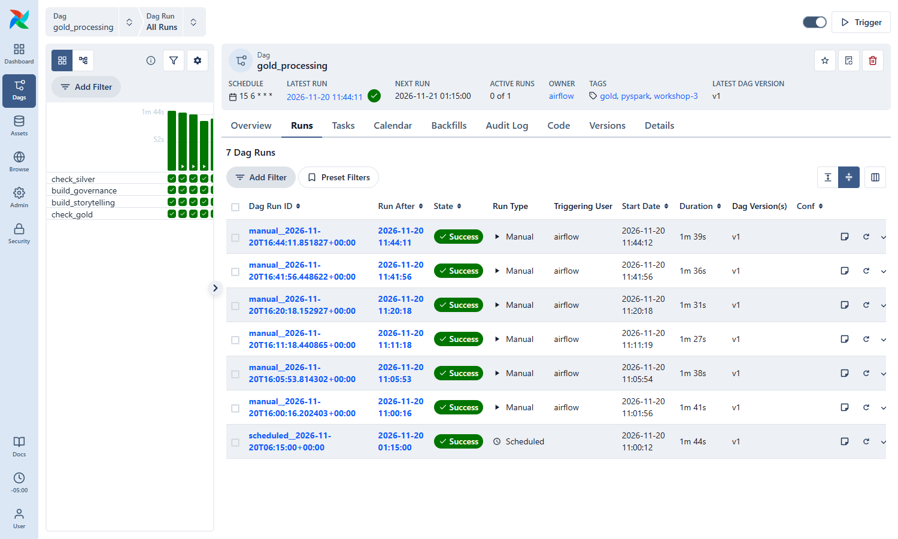
*Figure 6. Runs of `gold_processing`: one scheduled and manual runs, all successful.*

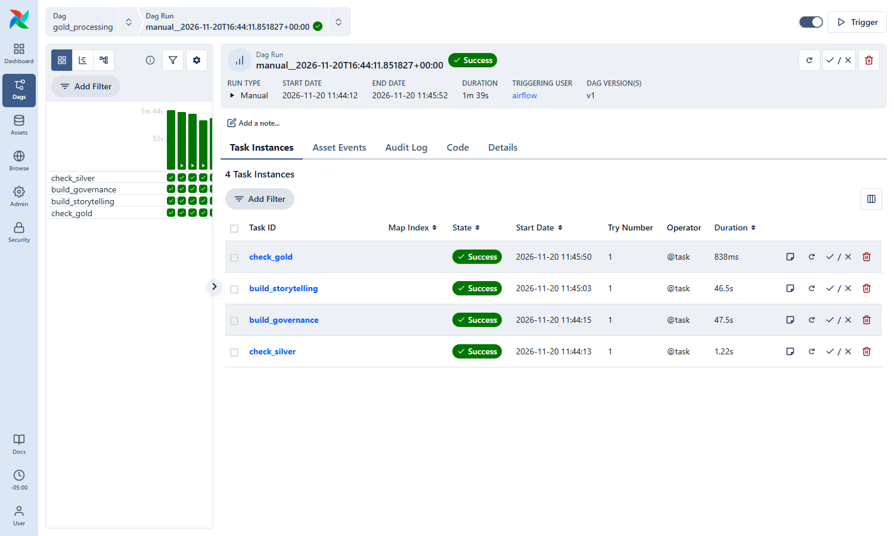
*Figure 7. Final run: governance 48 s, storytelling 46 s, 1 min 38 s in total.*

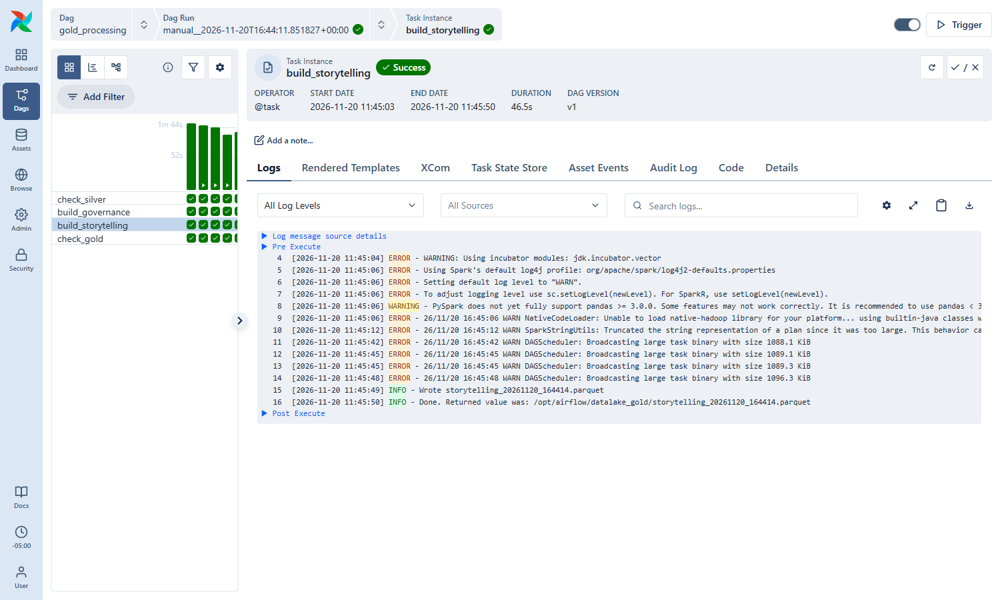
*Figure 8. Log of `build_storytelling`. Spark writes its warnings to stderr, which Airflow labels ERROR.*

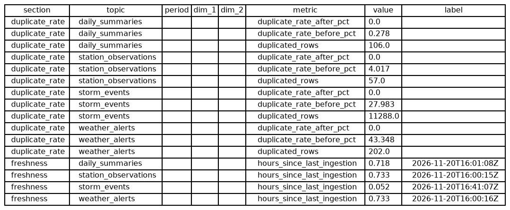
*Figure 9. Content of `governance_20261120_164414.parquet`: sections `duplicate_rate` and `freshness`.*

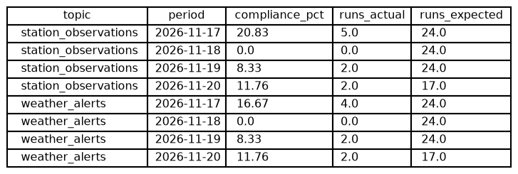
*Figure 10. Governance section `ingestion_compliance`.*

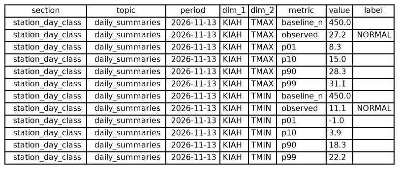
*Figure 11. Content of `storytelling_20261120_164414.parquet`: last rows of `station_day_class`.*

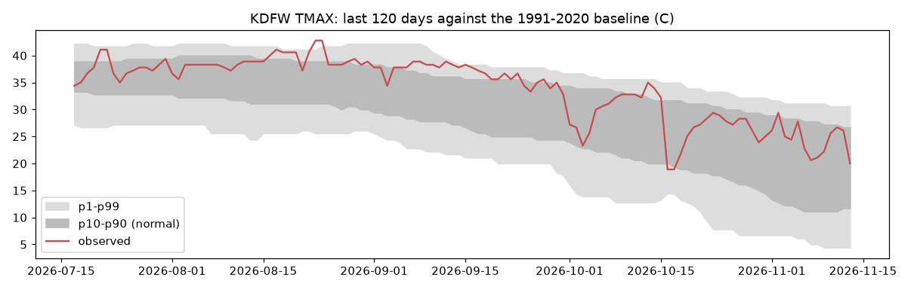
*Figure 12. KDFW maximum temperature against its baseline bands, drawn from the Gold file only.*

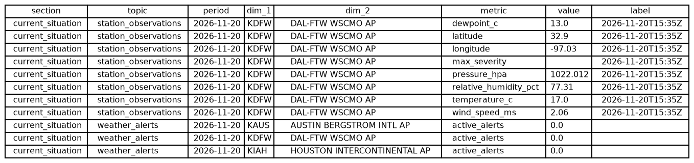
*Figure 13. Storytelling section `current_situation`: rows of KDFW and the active alerts of each station.*

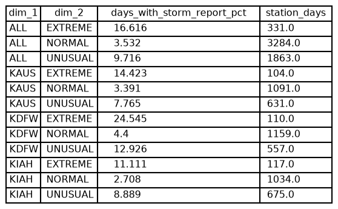
*Figure 14. Storytelling section `extreme_vs_storms`.*

## 8. Experimentation log

Things that did not work at first, and what we learned:

1. **Changing the hash rule created new duplicates.** After the `HASH_EXCLUDE` change, the next Silver run wrote
   202 alerts, 57 observations and 106 station-days again: those records came back in the overlap windows with
   the new hash, and Silver compared it with the old hash stored in earlier files. Fix: recompute the hash of the
   stored records with the current rule. Lesson: a stored derived value must be versioned or recomputed.
2. **Floating point noise.** 38 alerts still differed after the fix. The only difference was the last digit of
   the centroid longitude (-98.59857142857142 against ...43), because the order of the polygon vertices changed
   between two answers. The centroid is now rounded and left out of the hash.
3. **The first Gold test exposed a data gap.** The class distribution only covered 2025 and five weeks of    2026, which led to finding 7 and the historical loads. Checking the Course Project minimums afterwards showed
   the same gap in Storm Events; with five years, the EXTREME-storm relation appeared at KIAH too.
4. **Glob path warning.** Reading `datalake_silver/<topic>_*.parquet` logged a stack trace in every task;
   `pathGlobFilter` on the folder avoids it.
5. **Spark on Windows.** The local tests failed with "Python worker failed to connect back" because the workers
   started the Microsoft Store alias of `python`; `PYSPARK_PYTHON` now points to the driver interpreter.
6. **A test found a bug.** 29 February got the index of 1 March; the condition now starts at day 60 in leap years.
7. **Ingestion gaps in the KPI.** The first version of `ingestion_compliance` only listed days with runs, so the
   day without any run was invisible. The KPI now builds the calendar with `sequence` and fills 0.
8. **Null rate of flag columns.** `out_of_range` and `qc_failed` showed 100 % "null", but an empty value there
   means that nothing was flagged; they are left out of the KPI.

## 9. Limitations and next steps

- The baseline of KAUS has 26 complete years; `baseline_n` is published so the dashboard can show it.
- Three stations are configured; `config/pipeline.yaml` accepts `all` for the 46 stations of Workshop 1.
- Hours without Bronze runs cannot be recovered. A machine that is always on (or a cloud scheduler) is the
  real fix.
- The storm match uses the county and forecast zone of the station only, not the distance to the event.
- Workshop 4 will build the two Plotly Dash dashboards on the Gold files only, one per summary.

## 10. References

- Apache Spark. *PySpark API reference* (DataFrame, `functions.percentile_approx`, `Window`, `ml.feature.NGram`),
  version 4.x. https://spark.apache.org/docs/latest/api/python/
- Apache Spark. *Generic file source options: pathGlobFilter*. https://spark.apache.org/docs/latest/sql-data-sources-generic-options.html
- Apache Airflow. *Running Airflow in Docker* and *TaskFlow API*, version 3.x. https://airflow.apache.org/docs/
- National Weather Service. *API Web Service documentation* (User-Agent, caching, `Retry-After`).
  https://www.weather.gov/documentation/services-web-api
- OASIS. *Common Alerting Protocol Version 1.2* (status, msgType, severity). 2010.
- Menne, M. J., et al. (2012). Global Historical Climatology Network - Daily (GHCN-Daily), Version 3. NOAA NCEI.
  doi:10.7289/V5D21VHZ
- NOAA National Centers for Environmental Information. *Storm Events Database*. https://www.ncei.noaa.gov/stormevents/
- World Meteorological Organization (2017). *WMO Guidelines on the Calculation of Climate Normals* (WMO-No. 1203).
- Manning, C. D., Raghavan, P., & Schütze, H. (2008). *Introduction to Information Retrieval*, chapter 2
  (tokenization and stop words). Cambridge University Press.
- Wang, R. Y., & Strong, D. M. (1996). Beyond accuracy: What data quality means to data consumers.
  *Journal of Management Information Systems*, 12(4), 5-33.
- DAMA International (2017). *DAMA-DMBOK: Data Management Body of Knowledge*, 2nd ed., chapter 13 (data quality
  dimensions: completeness, uniqueness, validity, timeliness).
