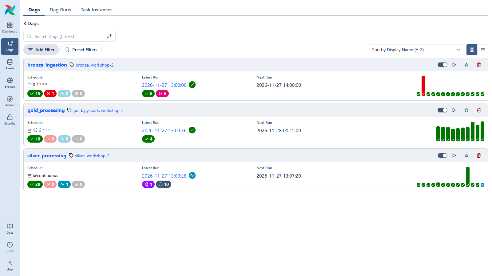
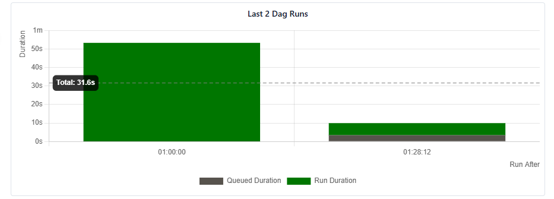
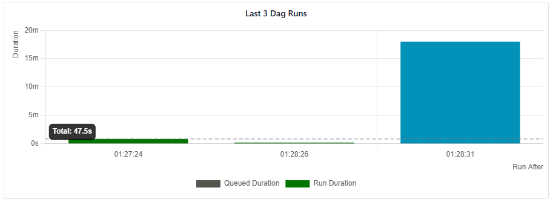
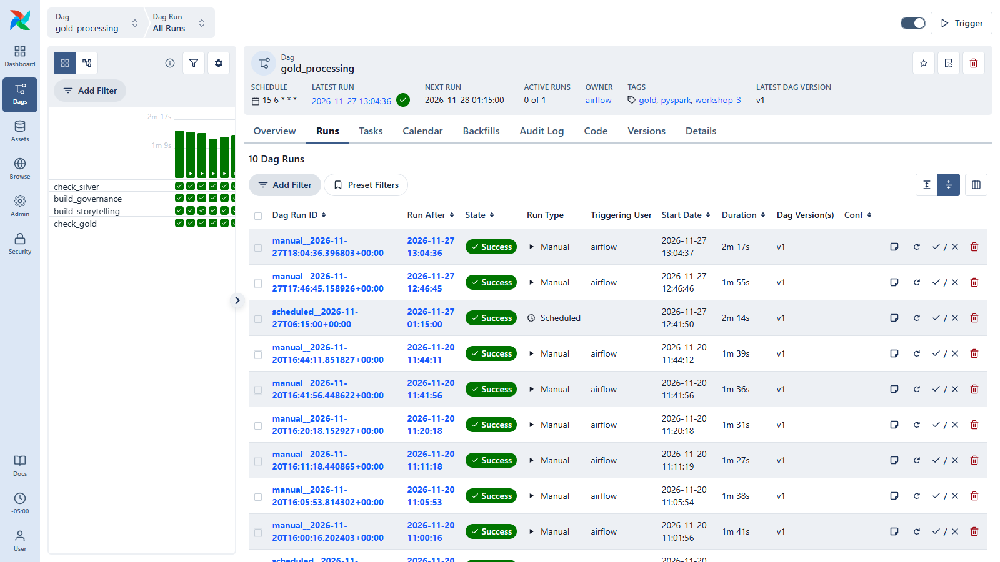
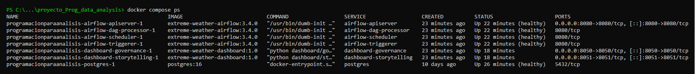
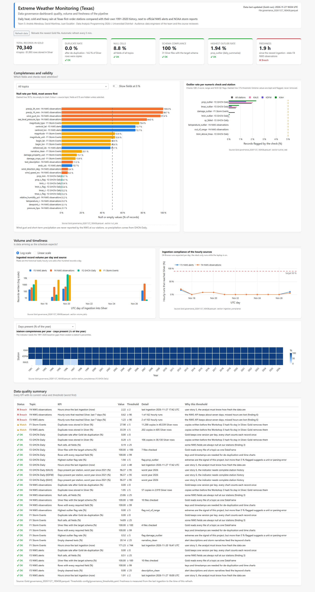
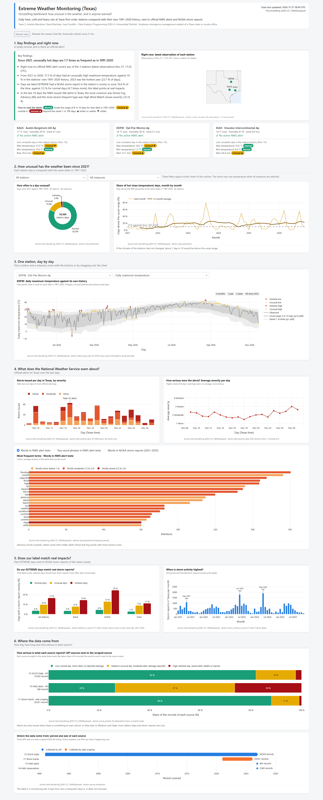
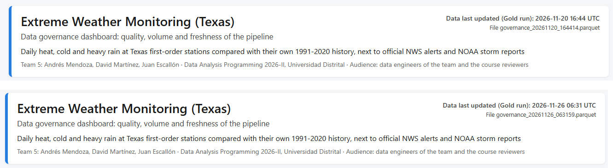

# Workshop 4 Report: Interactive Dashboards with Plotly Dash

**Project:** Extreme Weather Monitoring (Texas) 
**Team 5:** Andrés Mendoza, David Martínez, Juan Escallón 
**Course:** Data Analysis Programming 2026-I, Universidad Distrital. Prof. Carlos Andrés Sierra. 
**Repository:** https://github.com/UD4vyd/proyecto_Prog_data_analysis (branch `w4`, tag `v1.0-workshop4`)

## 1. Executive summary

Workshops 1 to 3 built a Medallion pipeline on Apache Airflow 3.4 in Docker Compose: hourly Bronze ingestion of
four NOAA sources, a FileSensor-driven Silver layer and a daily PySpark Gold layer that writes two Parquet
summaries. This workshop adds the layer people actually use:

- **Governance dashboard** (`dashboard/governance_app.py`, http://localhost:8050) for the engineers of the team
  and the course reviewers: six KPI cards, null rate per field, outlier rate per check and station, volume per
  ingestion day, hourly ingestion compliance, station completeness, and a summary table of 34 KPI values with
  their thresholds and status.
- **Storytelling dashboard** (`dashboard/storytelling_app.py`, http://localhost:8051) for the functional user of
  Workshop 1, an emergency-management analyst in a Texas state or county office. It tells one story in six
  steps, from "is anyone under an alert right now?" to "does our EXTREME label match real storm reports?".
- **Gold only.** Both apps read the newest `governance_*.parquet` or `storytelling_*.parquet` with
  `pd.read_parquet()` and nothing else. They reload the newest file every 5 minutes and with a button.
- **Integration.** Two Gold corrections (the keyword-severity association did not cover 9 of the 25 alert words
  shown in the keyword chart, and a new `source_severity` section puts the API and scraping sources on one
  severity scale so they can be compared), the KPI thresholds as configuration, a separate Docker image for the
  dashboards, a Poetry group for their libraries, and the Silver files of the final run committed with its Gold
  files so the Gold layer can be rebuilt from the repository (section 2).
- **Key insight for the analyst.** Since 2021, 17.5 % of the days at our three stations had an unusually high
  maximum temperature, against 10 % in their own 1991-2020 history (1.7 times as frequent; 23.7 % in 2023), and
  days we label EXTREME had a NOAA storm report in the station's county or zone 4.7 times as often as normal days
  (16.6 % against 3.5 %).

The numbers in this report come from the Gold files of the final end-to-end run, **2026-11-27 18:04 UTC**
(`governance_20261127_180438.parquet` and `storytelling_20261127_180438.parquet`, committed in `datalake_gold/`
together with the Silver files they were built from).
The dashboards were tested with Dash 3.4.0, Plotly 6.9.0 and Python 3.13.

**How the dashboard statement maps to our project.** As in Workshop 3, the statement is written for opinion
data. Our texts are official bulletins, so sentiment is replaced by two ordinal scores:

| Statement component | In this project |
|---|---|
| Sentiment distribution (pie / donut) | share of station-days NORMAL / UNUSUAL / EXTREME against 1991-2020 |
| Sentiment trend line | (a) monthly share of days above the usual range, with the 10 % expected; (b) mean CAP severity of the NWS alerts per day (1 Minor to 4 Extreme) |
| Top keywords coloured by sentiment | top words of NWS alert texts coloured by the mean severity of the alerts that use them |
| Source comparison (API vs scraping) | (a) share of Low / Medium / High records of F2 and F3 (APIs) next to F1 Storm Events (web scraping of the NOAA file listing), with the record count of each source; (b) period covered and records of F1 to F4 |
| Volume activity | alerts per day by severity, and Storm Events reports per month |
| Narrative summary card | key findings computed from the Gold file, in plain language |

## 2. Integration adjustments

These changes were made in Workshop 4. The Silver and Bronze improvements of Workshop 3 (record hash, text
cleaning, `Retry-After`, historical loads) are not repeated here.

| # | Problem found while connecting the dashboards | Change | Where |
|---|---|---|---|
| 1 | The keyword chart colours each of the 25 top alert words by severity, but `keyword_severity` ranked words by the number of alerts that contain them, a different top 25. 9 of the 25 words (`rip`, `high`, `beach`, `island`, `current`, `currents`, `risk`, `river`, `stage`) had no severity. | `keyword_severity` is now computed for exactly the words of `top_keywords`. New test `test_keyword_severity_covers_the_top_alert_words`. The dashboard still shows older Gold files (missing terms in grey, "No severity for this term"). | `src/gold/storytelling.py`, `tests/test_gold.py` |
| 2 | The governance KPIs had no thresholds, and the statement asks for "current values and defined thresholds". | Thresholds are configuration, not data: `config/governance_thresholds.yaml` holds the limit, direction, breach level and reason of each KPI. Gold stays the single source of the values. | `config/`, `dashboard/common/governance_prep.py` |
| 3 | `freshness` stores the hours since the last ingestion *at the Gold run*. Gold runs once a day, so on the dashboard the number was up to 24 h old. | The dashboard recomputes the age from the stored last-ingestion timestamp to the time of the refresh. | `governance_prep.freshness` |
| 4 | Gold files accumulate (one pair per run) and a run could be half-written while the dashboard reads. | The apps take the newest file by the timestamp in its name and cache it by name and modification time. The Gold writer already writes into a hidden folder and moves the finished file (Workshop 3), and the glob ignores hidden names; a test checks both. | `dashboard/common/data.py`, `tests/test_dashboard.py` |
| 5 | Installing Dash in the Airflow image would mix two Flask versions (Airflow pins its own). | Separate light image `dashboard/Dockerfile` (Python 3.12, Dash, Plotly, pandas, pyarrow) with two services, `dashboard-governance` and `dashboard-storytelling`, in `docker-compose.yml`. `datalake_gold/` and `config/` are mounted read-only. | `docker-compose.yml`, `dashboard/`, `.dockerignore` |
| 6 | The dashboard libraries were not declared. | Poetry group `dashboard` (Dash 3, Plotly 6, Dash Bootstrap Components 2) and `dashboard/requirements.txt` for the image; `requirements.txt` exported with the group. | `pyproject.toml`, `poetry.lock`, `requirements.txt` |
| 7 | `dashboard/README.md` (Workshop 1) planned to read a PostgreSQL model. | Rewritten: the course decided that Gold Parquet files are the only source of the presentation layer. | `dashboard/README.md` |
| 8 | The statement asks for the *sentiment* and volume of the API source next to the scraping source, but Gold only had the volume and period of each source: F1 Storm Events (the scraped source) has no class and no CAP severity. | New Gold section `source_severity`: every source on one common scale, the role of positive / neutral / negative. F2: NORMAL / UNUSUAL / EXTREME day. F3: Minor / Moderate / Severe or Extreme alert (`Unknown`, cancellations and test messages left out). F1: no reported damage or victims / property or crop damage above 0 / deaths or injuries. New 100 % stacked bar chart in step 6 of the storytelling dashboard, `check_gold` requires the section, new tests in both test files. | `src/gold/storytelling.py`, `src/gold/check.py`, `dashboard/`, `tests/` |
| 9 | The Gold files committed after the first end-to-end run (2026-11-26) were built from Silver files that were never committed, so the Gold layer could not be rebuilt from the repository. | The final run (2026-11-27) commits its four new Silver files with the final Gold pair; intermediate Gold files of that day are not committed. | `datalake_silver/`, `datalake_gold/` |

**End-to-end verification.** The pipeline was run end to end twice, on two laptops of the team.

1. *Fresh clone, 2026-11-26.* A Windows 11 laptop that had never run the project, a fresh clone of the repository
   and a new Airflow metadata database, following only the README. The Silver files committed in Workshop 3
   already hold the 1991-2026 GHCN-Daily history and five years of Storm Events, so no historical load was
   needed. `bronze_ingestion`, `silver_processing` (started by its FileSensor) and `gold_processing` all
   succeeded, and both dashboards showed the new Gold run after **Refresh data**. This run validated the README.
2. *Final run, 2026-11-27.* After adjustments 8 and 9, on a second laptop with `docker compose build` and
   `docker compose up -d`. `bronze_ingestion` ran at 17:41 UTC (all tasks successful; sources without new data
   are skipped), `silver_processing` wrote four new Silver files after its FileSensor saw the Bronze files, and
   `gold_processing` ran at 17:46 UTC and again at 18:04 UTC after the next hourly Bronze run. Each time
   `check_gold` confirmed the 9 Gold columns, the 12 governance sections and the 12 storytelling sections
   (including the new `source_severity`). After **Refresh data** both dashboards showed the 18:04 run in their
   headers (Figures 6 to 8). The stack was then stopped, so the committed Gold pair `20261127_180438` is the one
   described in this report.

With the corrected Gold code, all 25 alert words of the keyword chart have a severity colour (Figure 7).

## 3. Governance dashboard

**Audience and question.** A technical reader asks: can we trust what the pipeline produced today, and which
fields, checks or sources need attention?

**Layout** (top to bottom, designed on paper before coding):

1. Header: project title, topic angle, team, Gold run time and file name; **Refresh data** button (plus an
   automatic reload every 5 minutes that only redraws when a new file exists).
2. Six KPI cards.
3. "Completeness and validity": null rate per field (wide, left) and outlier rate per check (right).
4. "Volume and timeliness": volume per ingestion day and source (left), hourly ingestion compliance (right).
5. Station completeness heatmap (full width).
6. Data quality summary table, worst status first.

| Component | Gold section(s) | KPI (Workshop 3) | Interaction |
|---|---|---|---|
| Card "Total records in Gold" | `volume_total` | volume | - |
| Card "Duplicate rate" | `duplicate_rate`, `volume_total` | duplicate rate before / after de-duplication | status icon |
| Card "Null cells" | `null_rate`, `volume_total` | null rate (mean of field rates weighted by rows x fields = share of null cells) | status icon |
| Card "Schema compliance" | `schema_compliance` | % of Silver files with the target schema | status icon |
| Card "Highest outlier rate" | `outlier_rate` | outlier rate | status icon |
| Card "Freshness" | `freshness` | hours since last ingestion, per topic | status icon, stale topics named |
| Null rate bar chart (horizontal, sorted) | `null_rate` | null rate per field | topic filter, "show fields at 0 %" switch, hover |
| Outlier rate chart (grouped horizontal bars) | `outlier_rate` | outlier rate per check, all stations and per station | hover, legend toggle |
| Volume over time (grouped bars) | `volume_daily` | records per ingestion day and topic | log / linear switch, zoom |
| Ingestion compliance (line) | `ingestion_compliance` | hourly runs that reached Silver vs 24 expected | hover with runs |
| Station completeness (heatmap) | `station_completeness` | days present, TMAX / TMIN / PRCP nulls per station and year | metric selector |
| Data quality summary table | all of the above, `text_length` | every KPI, value, threshold, status, reason | - |

**Design rationale.** Cards first, because a reviewer reads the state before the detail; every card that can
break a threshold carries a coloured top border *and* an icon and word (✔ OK, ▲ Watch, ✖ Breach). The null
chart is horizontal because field names are long, sorted by severity, coloured by source topic and has a
reference line at 50 % ("too empty to chart"). The volume chart uses a logarithmic axis by default because a
historical load (36,925 rows in one day) and a day of hourly runs (15 alerts) differ by more than three orders of
magnitude. The table is
sorted worst first so the first rows are the actions to take.

**What it shows on the current data.** Gold holds 70,340 records. All four topics have 0 % duplicates after Gold
de-duplication (14.2 % of the 81,993 Silver rows were copies), 100 % schema compliance over 31 Silver files and at
most 1.94 % of records flagged by one check (precipitation outliers, which are real storms). The three critical
rows are timeliness. The screenshot was taken at 19:55 UTC, after the stack had been stopped, so the NWS
observations were 2.2 h old and broke their 2 h freshness limit (the newest source, NWS alerts, was 1.9 h old):
the card shows freshness up to the moment of the refresh, not of the Gold run (adjustment 3). Over the last 7 days
only 1 of 162 expected hourly runs of NWS observations (0.6 %) and 2 of 163 of NWS alerts (1.2 %) reached Silver,
because the stack of the final laptop was off between 2026-11-20 and 2026-11-27 (finding 6 of Workshop 3: the
stack only runs while a machine is on). The dashboard does what it should here: it makes the gap impossible to
miss.

## 4. Storytelling dashboard

**Functional user.** An emergency-management analyst in a Texas state or county office (Workshop 1, section 10).
The narrative question is the one of Workshop 3: *How unusual is the weather at our Texas stations compared
with their own 1991-2020 history, when does the National Weather Service warn about it, and do our EXTREME
days match real storm impacts?*

**Story flow** (overview to detail):

| Step | Components | Gold section(s) | User story |
|---|---|---|---|
| 1. Key findings and right now | Narrative summary card; map of the latest observation of each station (colour and shape: no alert / inside an alert); one card per station with current temperature, humidity, wind, alert status and the class of its last complete day | `current_situation`, `station_day_class`, plus the sections used by the findings | US2, US4 |
| 2. How unusual since 2021? | Donut of NORMAL / UNUSUAL / EXTREME station-days; line of the monthly share of days above the usual range with its 12-month average and the 10 % expected | `class_distribution` | US3 |
| 3. One station, day by day | Band chart: observed value against the p10-p90 and p1-p99 range of the same date in 1991-2020; triangles for unusual and extreme days | `station_day_class` | US3 |
| 4. What does the NWS warn about? | Alerts per day stacked by severity (volume activity); mean severity per day (trend line); top words of alert texts coloured by severity, with phrases and storm-report words as alternatives | `alert_severity_daily`, `top_keywords`, `keyword_severity` | US1 |
| 5. Does our label match real impacts? | Grouped bars: % of station-days with a storm report in the same county or zone, per class and station; storm reports per month with the three peaks labelled | `extreme_vs_storms`, `storm_monthly_volume` | US7 |
| 6. Where the data come from | Source comparison: 100 % stacked bars of Low / Medium / High records per source, API sources above the scraped source, with the record count of each; timeline of the period and size of each source, coloured by API or web scraping | `source_severity`, `source_comparison` | US5 |

Filters: station and measure for step 2 (applied to both charts), station and measure for step 3, keyword set
for step 4. Every chart has hover details; time charts zoom by dragging; the band chart has 3 months / 1 year /
3 years / all buttons.

**Narrative summary card.** The text is computed from the Gold file on every refresh, nothing is hard-coded.
On the current data it reads:

> *Since 2021, unusually hot days are 1.7 times as frequent as in 1991-2020.*
>
> - Right now no official NWS alert covers any of the 3 stations (latest observations Nov 27, 17:25 UTC).
> - From 2021 to 2026, 17.5 % of days had an unusually high maximum temperature, against 10 % in the stations' own
>   1991-2020 history. 2023 was the hottest year (23.7 % of days).
> - Days we label EXTREME had a NOAA storm report in the station's county or zone 16.6 % of the time, against
>   3.5 % for normal days (4.7 times more): the label points at real impacts.
> - In the last 19 days the NWS issued 368 alerts in Texas; the most common was Dense Fog Advisory (86) and the
>   most severe frequent type was High Wind Watch (mean severity 3.0 of 4).

The first finding changes with every run: on the morning of the 2026-11-26 run a Freeze Warning covered Austin
(KAUS), and the map and the KAUS card showed it in the alert colour; at the final run no alert covered a station.

**Source comparison.** On the final Gold file the three sources read very differently on the common scale:

| Source | Method | Records | Low | Medium | High |
|---|---|---|---|---|---|
| F2 GHCN-Daily (station-days since 2021) | API | 19,303 | 82.0 % | 15.6 % | 2.4 % |
| F3 NWS alerts (issued) | API | 368 | 26.4 % | 47.3 % | 26.4 % |
| F1 Storm Events (2021-2025) | web scraping | 29,051 | 88.1 % | 11.0 % | 0.9 % |

Alerts are only issued when there is something to warn about, so most of them are Medium or High, while most
station-days and most storm reports are Low: 88 % of the scraped storm reports list no damage and no victims. The
chart therefore says *what kind of signal* each source carries, not that one source is "more negative" than
another. The timeline below it counts 403 alert records, more than the 368 here, because it counts every stored
alert message: the difference is 34 cancellations and 1 test message, which are not new alerts.

**Plain language.** Labels avoid pipeline terms: "Usual range, 8 in 10 days" instead of p10-p90, "Rarest 1 %
limits" instead of p1-p99, "Max temperature" instead of TMAX, "Days with a storm report nearby" instead of
match rate. Each section title is a question, and a short note under some charts says how to read them ("If the
climate of the stations had not changed, about 1 day in 10 would be above the usual range"). For the same
reason ("would my user understand this chart without explanation?") two possible charts were left out: storm
impact per event type and alert count per event type. Both Gold sections are correct, but they do not answer the
narrative question and would make the page longer.

**Narrative rationale.** The analyst first needs the present (step 1, user stories 2 and 4), then the context
that makes the present meaningful (steps 2 and 3), then the official warnings (step 4), then the evidence that
the label deserves attention (step 5), and finally how fresh and broad the sources are (step 6). The GHCN-Daily
history arrives a few days late, so the station cards show both dates: "now" from the NWS observation and the
"last complete day" of the station history.

## 5. Visualization design decisions

**Chart types.** Line charts for every time series (share of hot days, mean severity, ingestion compliance);
bars for comparisons of categories (null rates, outliers, keywords, storm match), horizontal when labels are
long; stacked bars only where the parts add up to a meaningful total (alerts per day by severity, and 100 %
stacked bars for the source comparison, where each source has a different number of records and only the shares
are comparable; the counts sit next to the source names). The donut is
the only part-of-whole chart and has exactly three categories, as the statement recommends; with five classes
(high and low separated) we would have used bars. One heatmap, for a station x year matrix. No dual-axis
charts: alert volume and mean severity are two charts side by side.

**Colour.** One palette module (`dashboard/common/palette.py`) serves both dashboards. Every palette was checked
with a colour-vision-deficiency validator (OKLab colour difference under simulated protan, deutan and tritan
vision, plus contrast against the white surface):

| Palette | Colours | Rule | Check |
|---|---|---|---|
| Class (sentiment) | NORMAL `#1a9e77`, UNUSUAL `#e6ab02`, EXTREME `#a50f15` | statement: green positive, yellow neutral, red negative | a plain green / red pair failed for deuteranopia (Delta E 4.0); this bluish green and dark red pass every pair (worst Delta E 13.8) |
| Severity (ordinal) | Minor `#f4a259`, Moderate `#e4572e`, Severe `#b3261e`, Extreme `#6b0f0f` | one warm hue, light to dark | monotone lightness, light end above 2:1 contrast |
| Source topics | alerts `#257de0`, observations `#f47230`, daily `#00b894`, storms `#f2a600` | fixed colour per topic in both apps | adjacent pairs pass (worst Delta E 11.8) |
| Status | OK `#0aac23`, Watch `#d28e05`, Breach `#dc3c3d` | reserved for thresholds | always with an icon and a word |

Colour never carries meaning alone: high and low days use triangle up and down, stations inside an alert use a
diamond, statuses use icons and words, and every multi-series chart has a legend.

**Layout and legibility.** Dash Bootstrap Components grid inside a fluid container capped at 1,800 px: at 1080p
the charts sit in two columns and the page never scrolls horizontally; on narrow screens the columns stack.
Each dashboard has the header required by the statement (project title, topic angle, team, last updated). Every
chart has a descriptive title, a subtitle when the chart needs a reading hint, labelled axes with units, a legend
when there is more than one series, and a source note at the bottom left that names the Gold file and section.
A shared Plotly template (`dashboard/common/theme.py`) gives the same fonts, light grid and hover style to all
charts.

## 6. Reproducibility evidence

The project was first reproduced on a laptop that had never run it, from a fresh clone and following only
`README.md` (section "Workshop 4"): `.env` from `.env.example`, `docker compose build`, `docker compose up -d`, then
the three DAGs in sequence. The figures below are from the final run of 2026-11-27 (section 2), made the same way.

*Figure 1. The three DAGs in the Airflow UI at localhost:8080.*

*Figure 2. Successful runs of `bronze_ingestion`.*

*Figure 3. Runs of `silver_processing`, each started by the FileSensor after a Bronze file.*

*Figure 4. Runs of `gold_processing`, including the two runs of the final end-to-end test (17:46 and 18:04 UTC).*

*Figure 5. Output of `docker compose ps` during the final run: Airflow services and the two dashboard services.*

*Figure 6. Governance dashboard at localhost:8050, full page, with the Gold file of the final run.*

*Figure 7. Storytelling dashboard at localhost:8051, full page, with the Gold file of the final run.*

*Figure 8. Header of the governance dashboard before (Gold run of 17:46 UTC) and after **Refresh data** following
a new `gold_processing` run (18:04 UTC). Re-captured from the same two Gold files after the header text was
corrected.*

**Walkthrough video.** `workshop_4/evidence/09_dashboards_walkthrough.webm` (2 min 47 s, no audio) is a
screen recording of both dashboards, made on 2026-11-28 with the Gold files of that day. On-screen captions take
the place of narration: they name each section while the recording uses the filters, switches and tooltips of
both apps. It plays in Edge, Chrome or VLC and can be recorded again with
`python workshop_4/record_walkthrough.py` while the two dashboard services are running.

## 7. Challenges and resolutions

1. **No sentiment in weather bulletins.** Solved in Workshop 3 by two ordinal scores; here the challenge was to
   make them as readable as sentiment. The class gets the sentiment colours, and the severity gets its own warm
   ramp so the two scales are never confused.
2. **Green and red for colour-blind readers.** The statement asks for green and red; the first pair we tried was
   indistinguishable under deuteranopia. A validator picked a bluish green and a dark red that pass, and shapes
   were added as a second cue.
3. **Words without a severity.** The first keyword chart had 9 grey bars out of 25. The cause was in Gold (two
   different top-25 lists), so we fixed Gold instead of hiding the bars (adjustment 1).
4. **Scales that differ by orders of magnitude.** Volume per day: logarithmic axis with a linear switch. Source
   periods: 35 years of GHCN-Daily next to 4 days of observations, so each bar ends in a marker with the record
   count and the recent sources stay visible.
5. **Refresh without flicker.** An automatic reload that redraws every chart every few minutes would make the
   page jump while the analyst reads it. The reload now compares the file name with the one in a `dcc.Store` and only redraws when a new Gold
   file exists; the button always redraws.
6. **Stale freshness.** Freshness computed at the Gold run was out of date on the dashboard (adjustment 3). A second
   case appeared in the audit: because the automatic reload skips files it already shows, the KPI cards were
   not recomputed either, so freshness froze until a new Gold file arrived. The cards and the summary table now
   recompute on every automatic reload (they are cheap); only the charts wait for a new file.
7. **Library conflicts.** Dash and Airflow both depend on Flask; a separate dashboard image avoids the conflict
   (adjustment 5).
8. **Setting up a new Windows laptop.** The 2026-11-26 run was made on a machine that had never run the project, which
   exposed four problems the README now covers: Docker Desktop needed the Windows "Virtual Machine Platform"
   (`wsl --install` as administrator); the installed Python 3.14 is outside the project range, so Python 3.13 was
   installed next to it and selected with `poetry env use`; Windows Smart App Control blocked `pipx.exe`, so Poetry
   runs as a module (`py -3.13 -m poetry`); and PowerShell splits `--only main,dashboard` at the comma unless it is
   quoted. On that laptop the PySpark unit tests could not start Spark (no Hadoop binaries); on the second laptop
   they ran, and in any case the Gold code runs inside the Airflow containers, where both runs executed it.
9. **First look in a real browser.** The first screenshots showed rotated day labels over the axis title, minor
   labels on the logarithmic axis, threshold labels over the bars, a donut legend that collided with the slice
   labels and a source note cut off by long category labels. All five were fixed in the shared theme (two small
   commits) before the final screenshots.
10. **A sentiment for the scraped source.** The statement compares the sentiment of the API source with the
    scraping source, but Storm Events reports carry neither of our two scores. We defined a common three-level
    scale from their impact columns (adjustment 8) instead of leaving the scraped source out. Checking the first
    chart against the data corrected our own expectation: we assumed storm reports would lean to High, but 88 %
    of them list no damage and no victims, so the note under the chart was rewritten from the numbers.
11. **A scheduled Gold run that started too early.** When the stack of the final run started, Airflow launched
    the pending scheduled `gold_processing` run at the same moment as the first `bronze_ingestion` run, so that
    Gold file (17:42 UTC) was built before Silver had processed the new Bronze files. We triggered
    `gold_processing` again once Silver had finished and did not commit the early file. The README order
    (Bronze, wait for Silver, then Gold) avoids it.

## 8. Limitations and next steps

- Ingestion is only as continuous as the machine that runs Docker; the governance dashboard makes the gaps
  visible but cannot fill them. A machine that is always on, or a cloud scheduler, is the real fix.
- The common severity scale treats an unknown Storm Events damage (null, 15 % of the reports) as no reported
  damage, so the Medium share of F1 is a lower bound. The three sources also measure different things (a day, a
  warning, a reported event), so the chart compares the kind of signal of each source, not a single sentiment.
- Three stations are configured; with `stations: all` the station colours fall back to grey after the first
  three and the per-station charts would need small multiples.
- The NWS alert history covers only the days the pipeline has been running, so the alert charts describe a short
  window; the storm reports (2021-2025) carry the long-term part of the story.
- The dashboards have no authentication; they are meant to run on localhost.

## 9. References

- Plotly. *Dash Python User Guide* (layout, basic callbacks, `dcc.Interval`, `dcc.Store`), Dash 3.x.
  https://dash.plotly.com/
- Plotly. *Plotly Python Open Source Graphing Library* (graph objects, templates, `Scattergeo`), Plotly 6.x.
  https://plotly.com/python/
- Faculty AI / dbc-team. *Dash Bootstrap Components documentation*, version 2.x.
  https://dash-bootstrap-components.opensource.faculty.ai/
- pandas. *pandas.read_parquet*. https://pandas.pydata.org/docs/reference/api/pandas.read_parquet.html
- Few, S. (2006). *Information Dashboard Design: The Effective Visual Communication of Data*. O'Reilly.
- Munzner, T. (2014). *Visualization Analysis and Design*. CRC Press.
- Tufte, E. R. (2001). *The Visual Display of Quantitative Information*, 2nd ed. Graphics Press.
- Okabe, M., & Ito, K. (2008). *Color Universal Design (CUD): How to make figures and presentations that are
  friendly to colorblind people*. https://jfly.uni-koeln.de/color/
- W3C (2018). *Web Content Accessibility Guidelines (WCAG) 2.1*, success criteria 1.4.1 (use of colour) and
  1.4.11 (non-text contrast). https://www.w3.org/TR/WCAG21/
- Ottosson, B. (2020). *A perceptual color space for image processing* (OKLab). https://bottosson.github.io/posts/oklab/
- OASIS (2010). *Common Alerting Protocol Version 1.2* (severity levels).
- NOAA National Centers for Environmental Information. *Storm Events Database*. https://www.ncei.noaa.gov/stormevents/
- Menne, M. J., et al. (2012). Global Historical Climatology Network - Daily (GHCN-Daily), Version 3. NOAA NCEI.
  doi:10.7289/V5D21VHZ
- National Weather Service. *API Web Service documentation*. https://www.weather.gov/documentation/services-web-api
